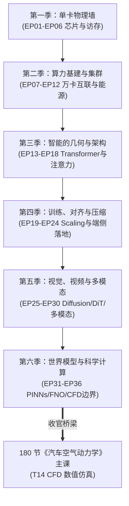
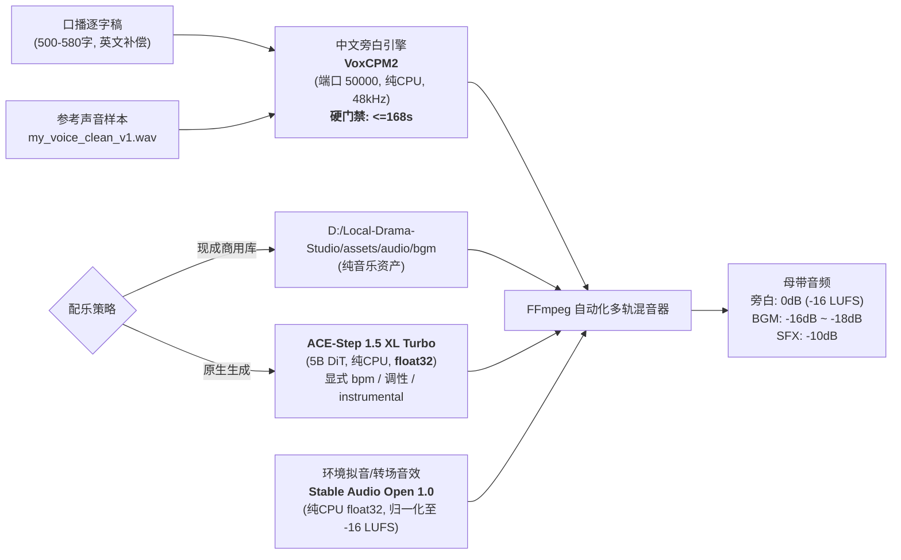

# 《AI 底层物理与系统工程通识》短视频生产规范与全景蓝图

> **版本**：v2.0-Editorial-Freeze  
> **视觉对标**：Vox / Branch Education / 3Blue1Brown / 《经济学人》信息图 (Light Technical Editorial)  
> **画幅标准**：**原生 9:16 竖屏（1080×1920）第一基准**，真双模响应式输出（`@media` 无损重排真 16:9，严禁黑边套壳）  
> **渲染管线**：**Playwright / 无头浏览器毫秒级时间轴自动化驱动**（严禁手动按空格录屏）  
> **视听结构**：**Blender 3D 硬件特写 (50%) + HTML 2D 高精信息图 (50%) 混剪**  
> **时长红线**：**死守 YouTube Shorts 180 秒上限，音频硬门禁 $\le 168$ 秒**  
> **与主课关系**：本系列为《汽车空气动力学》180 集主课与工业 CFD 的前端通识引流与算力底座支撑，收官集（EP36）直接对接流体力学传统求解器与 AI 代理模型边界。  
> **当前执行状态**：**蓝图定死，环境就绪，滚动填充**。存量短视频全部作废重做，第一阶段仅搭建环境目录与规范契约，不启动实际媒体渲染。

---

## 一、 战略定位与扩容架构

### 1. 为什么是“6 季 / 36 集”？
原有的 3 季（18 集）仅局限于“单卡计算 $\rightarrow$ 简单模型 $\rightarrow$ 图像生成”，遗漏了现代 AI 工业落地的三大支柱：**大规模集群与能耗约束**、**后训练/对齐/量化压缩**、以及**科学计算（AI for Science / PINNs / FNO）**。

扩充至 **6 季 / 36 集**（每集约 165 秒，总时长约 100 分钟）后，形成闭环的技术树：

### 2. 执行策略：蓝图定死，滚动填充
* **主课保护红线**：当前核心资源必须保卫 180 节《汽车空气动力学》主课进度，不得陷入短视频全面铺开导致的生产瘫痪。
* **优先级划分**：
  * **第一梯队（优先攻坚）**：第一季（EP01–EP06 单卡硬件瓶颈）与第五季（文生图/视频 DiT），每次打磨 1 集作为标准化样板。
  * **第二梯队（选题弹药库）**：其余季度（EP07–EP24、EP31–EP36）大纲与指标已全部冻结，当行业热点爆发时直接按编号插队生产。
  * **历史资产处置**：早期制作的短视频全部重做，以本规范重构的 EP02 黄金标准作为统一重塑基准。

---

## 二、 工程严谨与真实性铁律（去幻觉四维红线）

短视频科普必须兼顾“极高传播爽感”与“经得起资深芯片/系统工程师推敲”，严格执行以下**四维验收门禁**：

### 1. 知识深度与“去幻觉”红线（科学完整性）
* **禁止模糊类比代替机制**：允许使用直觉隐喻（如“全能教授 vs 一万名小学生”），但**必须在 15 秒内硬着陆至真实硬件/算法术语**（ALU、SRAM、HBM、TSV、GEMM 等），严禁通篇童话化、概念悬空。
* **算法复杂度卫生**：涉及系统加速机制时，必须严格区分**算力复杂度（FLOPs）**与**访存复杂度（Memory I/O）**。严禁将“通过片上缓存减少显存搬运带来的吞吐提升”（如 FlashAttention）混淆为“减少了浮点计算量”。
* **强制暴露工程反例与局限（Trade-off）**：任何工程方案皆有代价。**每集必须强制留出 20–30 秒剖析失效边界**（例如：GPU 畏惧条件分支导致的 Warp Divergence；量化导致长尾精度下降；PINNs 在高雷诺数湍流分离区的剧烈发散）。严禁单方面吹嘘“神级突破”。
* **严禁杜撰与推测**：所有硬件参数、功耗数据、加速比必须有据可查，绝不可为了剧本冲突编造虚假数字。

### 2. 定量时间与字数硬约束（Shorts 180 秒红线）
* **总时长硬门禁**：必须严格锁定在 **$\le 168$ 秒**（预留 12 秒安全缓冲，死守 YouTube Shorts 180 秒红线，防止被平台降级为长视频丢流量池）。
* **口播总字数**：严格控制在 **500 – 580 个汉字**（按照 210–215 字/分钟的标准沉稳语速核算，包含英文缩写 `ALU`、`SRAM`、`TFLOPS` 的耗时补偿）。
* **零废话开局与收尾**：
  * **前 3 秒**：直接抛出核心物理矛盾或反直觉工程现象（禁止“大家好我是XX”）。
  * **最后 5 秒**：直接收束为下一集的物理悬念钩子（禁止“求三连求关注”）。

### 3. 原生 9:16 优先与真双模规范
* **第一基准**：按 **1080×1920 (9:16)** 竖屏全屏原生排版设计。
  * 顶部 200px：避让平台状态栏，放置极简系列编号与出处溯源。
  * 核心舞台 1300px：上下双层硬件架构对比与实时数据管道，正文字号 $\ge 34\text{px}$。
  * 底部 420px：保持纯净暖白背景留给外挂大字幕与平台按钮，绝不遮挡核心图表。
* **真横屏响应式适配**：若需发布 B 站/YouTube 16:9，**绝不采用加黑边缩放的偷懒套壳方案**。在 CSS 中通过 `@media (min-aspect-ratio: 16/9)` 响应式查询，将“上下双栏”自动展开为“左右双栏”，以同一套代码原生输出无损 16:9。

### 4. 引用与数据溯源规范
* 凡引用论文实测对比、吞吐量倍率、芯片 Die Shot 面积、功耗数字时，画面角落必须以浅灰色极小字号显式标注论文作者年份或官方规格书（例如：`Dao et al., 2022 (FlashAttention)`、`NVIDIA H100 Architecture Whitepaper`）。

---

## 三、 视觉设计与分镜 SOP (Light Technical Editorial)

对标 Vox / 《经济学人》信息图质感，彻底清除“网页 UI 痕迹”：

### 1. 暖纸与陶土橙色彩系统
* **暖白纸底色**：`#FBFAF7`（温润纸张感，拒绝刺眼纯白）。
* **微色块底衬**：`#F3F1EA`（用于芯片功能区分区背景）。
* **墨黑主结构与文字**：`#1C1917` / `#2E3338`（极高对比度，边缘锐利）。
* **陶土橙焦点**：`#E8733B`（**全屏严格占比 < 5%**，仅用于正在讲解的算力单元、关注度权重与性能突变提示）。
* **工科青蓝数据流**：`#3B8276`（正向处理与总线流向）。
* **建筑制图网格**：`1px` 极细实线 `#E7E5E4`，辅以四角制图十字标。

### 2. 彻底清除网页 UI 杂质（无声观看秒懂原则）
* **禁止任何控制台按键提示**：删除底部 `Step 1-4 / 按空格推进` 等所有调试按钮，快捷键转入后台静默监听。
* **禁止网页大卡片与虚线框**：改用真实比例面积图（Treemap）与 1px 精密工业图线。
* **禁止 `⚠` 网页弹窗**：Warp Divergence 采用**纯视觉状态演进**——GPU 密集算力阵列奇数行保持橙色高亮脉冲，偶数行瞬间变为斜线锁定停摆态，下方指示条动态拉长 100%，无声观看亦能秒懂性能腰斩。

### 3. 持续物理微动效（防画面僵死）
* 画面停留超过 2 秒时，画面内部必须保持微米级总线粒子流（Bus Stream）与算力单元呼吸脉冲（Pulse Scan），杜绝死板 PPT 截图感。

### 4. 混剪结构规范（Blender 3D + HTML 2D）
* **混剪比例**：**50% 3D 真实硬件微距特写 + 50% HTML/SVG 高精信息图**。
* **3D 硬件特写**：每集调用资产库中真实芯片/显卡微距模型（如 RTX 3090 拆解、BGA 芯片封装、硅晶圆暗调微距），采用 `#FBFAF7` 同色系影棚布光，无缝切入 HTML 晶圆面积对比。

---

## 四、 声音导演与本地模型调用管线（对接 Local-Drama-Studio）

根据本地算力环境与 `@D:\Local-Drama-Studio\README.md` 的工业级生产实践，建立标准化本地音视频资产管线：

### 1. 旁白合成（TTS）与时长报警
* **引擎**：`VoxCPM2`（零样本声音克隆，端口 `50000`，本地 CPU 调度）。
* **音色参考样本**：`D:/Local-Drama-Studio/assets/audio/prompts/my_voice_clean_v1.wav`。
* **时长硬门禁**：生成后自动检测总时长，**一旦超过 168 秒立即触发报警并阻断**，强制精简口播词。

### 2. 背景配乐（BGM）规范
* **风格定位**：克制、冷静、科技感、机械感、纯器乐（Ambient, Minimalist Electronic, Modern Classical）。严禁花哨喧嚣的土嗨神曲。
* **现成音频资产**：直接取用 `D:/Local-Drama-Studio/assets/audio/bgm/` 下的商用免版税资产。
* **原生生成管线（ACE-Step 1.5 XL Turbo）**：
  * **CPU 运行铁律**：**必须指定 `torch_dtype=torch.float32`**。禁止使用 `bf16`。
  * **参数控制**：纯器乐必须传 `lyrics=""`，caption 注明 `instrumental, minimalist, tech ambient`，显式指定 `bpm`（如 90–110）与调性。

### 3. 环境与界面拟音（SFX）
* **引擎**：`Stable Audio Open 1.0`（纯 CPU float32 生成，上限 47s）。
* **电平补偿**：模型原始输出电平极低（RMS −50 dBFS），脚本输出后**必须使用 FFmpeg `loudnorm` 滤镜自动归一化到 −16 LUFS**。

### 4. 自动化混流标准
* 旁白人声轨：居中，响度基准 −16 LUFS。
* BGM 音乐轨：**低音衰减 + 恒定衰减至 −16 dB ~ −18 dB**。
* SFX 交互轨：**衰减至 −10 dB**。

---

## 五、 完整 6 季 / 36 集全景课程地图（冻结版）

| 季度 | 集数 | 单集标题 | 核心物理/工程命题（一针见血） | 状态标记 |
| :--- | :--- | :--- | :--- | :---: |
| **第一季：单卡物理墙** *(芯片与访存瓶颈)* | **EP01** | CPU 为什么卡死在 5 GHz？ | 功耗立方律与硅基散热的热阻天花板 | 待重做 |
|  | **EP02** | CPU vs GPU：为什么大模型必须用“人海战术”？ | 复杂控制逻辑（低延迟）vs 密集计算阵列（高吞吐）的架构取舍 | **规范冻结·黄金样板** |
|  | **EP03** | 显存带宽墙：为什么显卡算力没满，生成却卡死了？ | 算力过剩（FLOPS）与数据搬运（Bytes/s）严重失衡的“内存墙” | 待重做 |
|  | **EP04** | KV Cache 的代价：大模型聊得越长越慢的物理真相 | 空间换时间策略下，上下文长度如何线性吃光显存容量与带宽 | 蓝图就绪 |
|  | **EP05** | HBM 高带宽内存：为什么它比 GPU 核心还金贵？ | 传统 PCB 平面走线的物理极限与 3D 硅通孔（TSV）垂直堆叠 | 蓝图就绪 |
|  | **EP06** | AI 芯片的散热极限：当风冷失效，流体力学如何救场？ | 高热流密度下的对流换热边界层与微通道液冷工质相变 | 蓝图就绪 |
| **第二季：算力基建与集群** *(万卡互联与能源)* | **EP07** | NVLink 与高速互联：几万张显卡怎么才能像一张卡一样工作？ | PCIe 带宽瓶颈与 GPU 之间点对点高带宽互联的拓扑结构 | 蓝图就绪 |
|  | **EP08** | 分布式训练的三座大山：数据并行、张量并行与流水线并行 | 单卡装不下千亿参数时，如何切分模型并控制跨卡通信延迟 | 蓝图就绪 |
|  | **EP09** | 算力的尽头是电力：一座万卡智算中心到底有多耗电？ | 芯片功耗、PUE 能源效率比与电网供电容量的物理约束 | 蓝图就绪 |
|  | **EP10** | 推理与训练的算力账：为什么部署大模型比训练更烧钱？ | 一次性训练成本 vs 亿级并发推理（Prefill 与 Decode 阶段分离） | 蓝图就绪 |
|  | **EP11** | 通信掩盖与计算重叠：分布式系统里的“时间管理大师” | 如何让显卡在传输数据的同时不停算，榨干每一毫秒硬件利用率 | 蓝图就绪 |
|  | **EP12** | 容错与断点续训：万卡集群每天必坏几张卡，训练怎么不白跑？ | 大规模硬件故障率统计规律与高频 Checkpoint 状态快照机制 | 蓝图就绪 |
| **第三季：智能的几何与架构** *(神经网络核心原理)* | **EP13** | 词嵌入（Embedding）：文字在万维空间里长什么样？ | 离散符号向连续高维向量空间的映射，以及余弦相似度的几何意义 | 蓝图就绪 |
|  | **EP14** | Transformer 注意力机制：一句话里的“引力场” | Query/Key/Value 矩阵点积如何动态计算词元间的语义关联权重 | 待重做 |
|  | **EP15** | FlashAttention 加速秘籍：不减算力，为何能快 3 倍？ | 利用 GPU 片上高速 SRAM 分块计算（Tiling），绕开慢速 HBM 读写 | 蓝图就绪 |
|  | **EP16** | MoE 混合专家模型：为什么 30B 模型能跑出大模型的智商？ | 稀疏激活机制与门控路由器（Router）如何在计算量与参数量间解耦 | 蓝图就绪 |
|  | **EP17** | 位置编码（RoPE）：大模型是怎么分清“我爱你”和“你爱我”的？ | 自注意力机制的排列不变性缺陷，以及旋转位置编码的复数几何优雅 | 蓝图就绪 |
|  | **EP18** | 长上下文的秘密：大模型是如何一口气读完百万字小说的？ | 注意力二次方复杂度 $O(N^2)$ 爆炸，以及滑动窗口、线性注意力与外推技术 | 蓝图就绪 |
| **第四季：训练、对齐与压缩** *(从预训练到端侧落地)* | **EP19** | 缩放定律（Scaling Law）：为什么“大力出奇迹”成了科学？ | 算力、数据量与参数量的幂律关系，以及预测模型性能的工程确定性 | 蓝图就绪 |
|  | **EP20** | 预训练与微调：通才模型是如何变成行业专家的？ | 自监督下一词预测（Next-Token Prediction）与监督微调（SFT）的边界 | 蓝图就绪 |
|  | **EP21** | RLHF 与强化学习推理：大模型是如何学会“慢思考”的？ | 人类偏好对齐、奖励模型，以及测试时计算（Test-Time Compute）的推理链演化 | 蓝图就绪 |
|  | **EP22** | 量化（INT4/FP8）的魔法：把大模型压小一半，为什么没变傻？ | 浮点数精度压缩、权重异常值（Outliers）保护与低比特矩阵乘法加速 | 蓝图就绪 |
|  | **EP23** | 知识蒸馏：如何把 600B 巨无霸的“内功”传给 8B 小模型？ | 教师模型的软标签概率分布（Logits）与学生模型的特征对齐 | 蓝图就绪 |
|  | **EP24** | 端侧本地部署实战：16GB 内存笔记本跑大模型的极限调优 | GGUF 量化格式、内存映射（mmap）与 CPU/GPU 混合推理的带宽博弈 | 蓝图就绪 |
| **第五季：视觉、视频与多模态** *(生成式 AI 底层机制)* | **EP25** | 文生图（Diffusion）本质：一场可控的“逆向热力学扩散” | 前向加噪（熵增）与神经网络预测噪声逆向还原（熵减）的物理直觉 | 蓝图就绪 |
|  | **EP26** | 潜空间（Latent Space）：为什么 Stable Diffusion 不直接画像素？ | 变分自编码器（VAE）将高维像素压缩至低维流形，算力直降几十倍 | 蓝图就绪 |
|  | **EP27** | ControlNet 与 LoRA：如何给脱缰的 AI 画师套上缰绳？ | 低秩矩阵分解旁路微调（LoRA）与零卷积空间条件控制（ControlNet） | 蓝图就绪 |
|  | **EP28** | 视频生成（DiT）的时空挑战：为什么 AI 经常画错物理碰撞？ | 空间注意力加上时间轴后的计算量级跃迁，以及缺乏因果物理约束的局限 | 蓝图就绪 |
|  | **EP29** | 音频与语音克隆：你的声音是如何变成一串离散 Token 的？ | 声学特征编码、流匹配（Flow Matching）与零样本音色克隆的韵律建模 | 蓝图就绪 |
|  | **EP30** | 多模态融合：大模型是如何同时“看懂”图片和“听懂”声音的？ | 视觉编码器（ViT）与文本对齐投影层如何把不同感官映射进同一语义空间 | 蓝图就绪 |
| **第六季：世界模型与科学计算** *(跨界桥梁：通向物理与 CFD)* | **EP31** | 世界模型（World Models）：AI 怎样才能真正学会牛顿定律？ | 从“统计像素相关性”跨越到“理解三维空间、遮挡与动力学因果” | 蓝图就绪 |
|  | **EP32** | 神经辐射场与 3D 高斯泼溅：AI 如何从几张照片重建三维世界？ | 可微渲染、隐式神经场（NeRF）与显式 3D 椭球光栅化的工程效率革命 | 蓝图就绪 |
|  | **EP33** | 具身智能的物理鸿沟：为什么机器人叠衣服比写代码难一万倍？ | 莫拉维克悖论、Sim-to-Real（仿真到现实）摩擦系数与柔性体力学难题 | 蓝图就绪 |
|  | **EP34** | PINNs 物理信息神经网络：把偏微分方程写进 Loss 函数 | 传统纯数据驱动 AI 的外推失效，与将质量/动量守恒嵌入损失函数的混合求解 | 蓝图就绪 |
|  | **EP35** | 神经算子（FNO）：用 AI 在毫秒级预测流体速度场与压力场 | 从学习“点对点映射”升级到学习“函数空间算子”，加速气动外形寻优 | 蓝图就绪 |
|  | **EP36** | AI + CFD 终极边界：AI 能取代传统流体仿真求解器吗？ | *(收官引流主课)* 高雷诺数湍流、激波捕捉与工程适航认证下传统求解器的不可替代性 | 蓝图就绪 |

---

## 六、 规范黄金样板：EP02 完整制作交付标准

### 1. 单集元数据核算
* **编号**：EP02
* **标题**：CPU vs GPU：为什么大模型必须用“人海战术”？
* **画幅**：原生 9:16（1080×1920），支持响应式 16:9
* **核定总时长**：165 秒（硬上限 168 秒）
* **核定字数**：548 汉字（按 215 字/分钟标准沉稳语速核算）
* **视觉基色**：暖白纸面 `#FBFAF7`，墨黑 `#1C1917`，陶土橙 `#E8733B`（<5%），制图灰线 `#E7E5E4`。

### 2. 口播逐字稿（直接用于 TTS 合成）
> **【00:00 - 00:15｜痛点破题】**  
> 单个核心算得飞快，甚至能把单线程性能拉满，为什么跑起大模型，顶级 CPU 却被几千个“笨核心”组成的 GPU 甩开几十倍？答案不在主频高低，而在芯片面积分配的底层物理取舍。  
>  
> **【00:15 - 00:50｜直觉隐喻】**  
> 你可以把 CPU 看作一位全能的菲尔兹奖数学教授，而把 GPU 看作一万名只会做小学加减法的小学生。如果今天要解一道极其复杂的微积分方程，教授一分钟就能搞定，小学生看都看不懂。但如果任务变成批改一万张两位数乘法口算卷，教授因为一次只能改一张，改到天黑也改不完；而一万名小学生每人发一张，一秒钟就能同时交卷。大模型推理与训练的核心，恰恰就是这海量的矩阵乘法口算卷。  
>  
> **【00:50 - 01:55｜硬件架构与底层机制拆解】**  
> 回到真实芯片硅片上，晶体管总数和功耗墙是固定的，设计师必须在“控制逻辑”和“算术逻辑单元”之间做取舍。CPU 内部超过百分之七十的面积，都用来堆叠庞大的控制单元（Control Unit）和多层高速缓存（L1/L2/L3 Cache）。它的目标是不惜一切代价降低单条指令的延迟，应对操作系统里充满分支预测和突发中断的复杂逻辑。相反，GPU 砍掉了绝大部分复杂的分支预测器和大缓存，把百分之八十以上的晶体管面积，全部铺满了结构极其简单的算术逻辑单元（ALU），也就是密集的 CUDA Core 和 Tensor Core 阵列。面对神经网络动辄上亿次的乘加运算，GPU 用极高的并行吞吐量，掩盖了单个核心计算慢的短板。  
>  
> **【01:55 - 02:28｜工程代价与失效边界】**  
> 但人海战术绝不是没有代价的。由于缺乏复杂的控制逻辑和独立大缓存，GPU 极度害怕条件分支和内存随机跳转。一旦代码里出现大量 `if-else` 逻辑判断，整排计算核心就必须排队等待，并行效率瞬间暴跌。这也是为什么操作系统调度、数据库复杂查询和串行逻辑控制，依然必须依赖 CPU，GPU 只能作为协处理器存在。  
>  
> **【02:28 - 02:45｜跨集悬念钩子】**  
> 不过，即使 GPU 已经塞进了上万个计算核心，工程上很快又撞上了另一堵墙：核心算得太快，数据却送不过来。下一集，我们拆解让无数大模型卡死的真正元凶——显存带宽墙。

### 3. 混剪视听分镜表（Blender 3D + HTML 2D）

| 镜号 | 时间段 | 视觉呈现模式 | 核心视觉元素与构图（9:16 原生） | 动态呈现与状态转移 | 口播逐字稿 |
| :--- | :--- | :--- | :--- | :--- | :--- |
| **S01** | `00:00-00:08` | **Blender 3D** | 工作站主板俯拍推镜头，CPU 散热器与双卡 GPU 并列特写（#FBFAF7 影棚暖光） | 镜头匀速缓慢推进 3%，微距景深虚化 | 单个核心算得飞快，甚至能把单线程性能拉满，为什么跑起大模型，顶级 CPU 却被几千个“笨核心”组成的 GPU 甩开几十倍？ |
| **S02** | `00:08-00:15` | **HTML 2D** | 顶部题头锁定，中部晶圆外框 `DIE BOUNDARY`，极细十字对齐标 | 分割滑块动态博弈，面积指示柱微弱呼吸 | 答案不在主频高低，而在芯片面积分配的底层物理取舍。 |
| **S03** | `00:15-00:28` | **HTML 2D** | 上下双通道：上层 1 个复杂偏微分方程，下层 10,000 张口算卷 | 方程收敛亮起青绿微标，下层阵列流动 | 你可以把 CPU 看作一位全能的菲尔兹奖数学教授，而把 GPU 看作一万名只会做小学加减法的小学生... |
| **S04** | `00:28-00:43` | **HTML 2D** | 串行时间轴 vs 并发整屏矩阵同时完成 | 左侧单指针逐格耗时推进，右侧整屏同步亮起 | 但如果任务变成批改一万张两位数乘法口算卷，教授改到天黑也改不完；一万名小学生一秒钟就能同时交卷。 |
| **S05** | `00:43-00:50` | **Blender 3D** | 硅晶圆 BGA 封装内部芯片微距显微特写，微米级引线发光 | 摄影机沿硅片表面掠过，光斑沿总线流转 | 大模型推理与训练的核心，恰恰就是这海量的矩阵乘法口算卷。 |
| **S06** | `00:50-01:12` | **HTML 2D (Step 1)** | CPU 真实比例 Treemap：控制+多级缓存占 >70%，ALU 占 <20% | 缓存块轻微呼吸，单指令延迟 `0.18ns` 陶土橙高亮 | 回到真实芯片硅片上，晶体管总数和功耗墙是固定的...CPU 内部超过百分之七十的面积堆叠控制与多级缓存... |
| **S07** | `01:12-01:38` | **HTML 2D (Step 2)** | GPU 密集阵列：128 个微米级 Warp 算力核心铺满整屏 (>80%) | 吞吐量柱瞬间拉满至 `67.5 TFLOPS (30x)`，粒子流高速通过 | 相反，GPU 砍掉了绝大部分复杂分支预测器，把 80% 以上面积全部铺满极其简单的算术逻辑单元... |
| **S08** | `01:38-01:55` | **HTML 2D (Step 3)** | 双层并列指标：单核延迟 (CPU 胜) vs 并发吞吐 (GPU 胜) | 上下双层同时发光对比，总线粒子对比流速 | 面对神经网络动辄上亿次的乘加运算，GPU 用极高的并行吞吐量，掩盖了单个核心计算慢的短板。 |
| **S09** | `01:55-02:15` | **HTML 2D (Step 4)** | **纯视觉 Warp Divergence**：GPU 奇数核心橙色执行，偶数核心斜线锁定停摆 | 偶数核心半透明停滞，下方耗时条动态拉长 100% | 但人海战术绝不是没有代价的。由于缺乏复杂控制逻辑，一旦出现大量 if-else，整排核心排队等待，效率暴跌。 |
| **S10** | `02:15-02:28` | **Blender 3D** | CPU 协同 GPU 异构主板全貌，PCIe/NVLink 高速总线光路流转 | 光线在 CPU 与 GPU 之间穿梭，展现协同分工 | 这也是为什么操作系统调度、数据库复杂查询和串行逻辑控制，依然必须依赖 CPU，GPU 只能作为协处理器存在。 |
| **S11** | `02:28-02:45` | **HTML 2D** | 算力核心 100% 就绪，但显存进料管道狭窄红灯阻塞 | 算力阵列空转等待，数据管道红浪脉冲，定格悬念 | 不过，即使塞进了上万核心，工程上很快又撞上了另一堵墙：核心算得太快，数据送不过来。下集拆解——显存带宽墙。 |

---

## 七、 验收证据检查表

1. **画面审美**：暖白纸 `#FBFAF7` + 墨黑 `#1C1917` + 陶土橙 `#E8733B` (<5%) + 1px 网格线，彻底杜绝廉价网页卡片与 `⚠` 弹窗。
2. **构图原生**：1080×1920 (9:16) 原生构图，正文字号 $\ge 34\text{px}$，上下安全避让，支持媒体查询无损重排 16:9。
3. **自动化管线**：支持 `window.seek(t)` 与 `?t=...` 毫秒级程序驱动无头渲染。
4. **视听结构**：50% Blender 3D 实景微距 + 50% HTML 2D 高精度信息图。
5. **Shorts 门禁**：TTS 时长硬性限制 $\le 168$ 秒，死守 180 秒红线。
