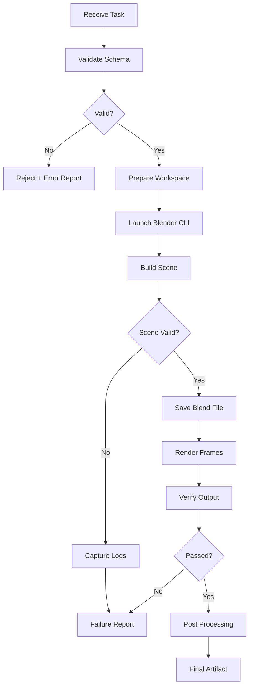

# AI + Blender 自动化三维内容生产技术方案

> 归档日期：2026-11-03
> 状态：技术基线（Architecture Baseline）
> 落地映射与阶段进度见 [AI-Blender 落地路线图](AI-Blender落地路线图.md)。

方案定位：建立一套由 AI 驱动、Python 编排、Blender 执行的通用三维内容生产系统。

本方案不限定具体应用项目，不预设制作汽车动画、Transformer、财经视频或其他内容。系统需要具备通用性，能够根据不同任务配置，完成三维场景构建、程序化建模、材质设置、动画控制、渲染及视频输出。

核心目标不是让大模型直接操作 Blender，而是建立一套具有明确接口、可重复执行、可测试、可扩展的自动化生产体系。

## 1. 总体技术架构

```text
AI 层（LLM / Agent）
  需求解析、场景规划、参数生成、错误分析
        │
        ▼
任务描述层（JSON / Pydantic）
  Schema、类型约束、资源引用、任务配置
        │
        ▼
编排控制层（Python Orchestrator）
  任务调度、参数验证、执行管理、日志、状态管理
        │
        ▼
Blender CLI
  进程与渲染执行
        │
        ├── bpy API             场景与数据操作
        ├── Geometry Nodes      程序化几何
        └── Animation System    动画与时间轴
        │
        ▼
输出处理层
  PNG / EXR / 视频序列 / FFmpeg / 最终媒体文件
        │
        ▼
质量验证与资产管理
  自动检查、渲染验收、资源版本、执行报告
```

### 架构设计原则

1. AI 与 Blender 执行环境分离。
2. 使用结构化数据作为任务接口，而非无限制代码注入。
3. Blender 原生 API 负责三维操作。
4. Geometry Nodes 负责可复用的程序化几何计算。
5. Python 负责任务生命周期和外部依赖管理。
6. 输出采用中间文件与最终文件分离的方式。
7. 所有关键执行步骤可记录、可复现、可验证。

## 2. 核心技术选型

### 2.1 Blender 执行与控制

| 技术 | 定位 | 选型 |
| --- | --- | --- |
| Blender | 三维引擎 | 核心 |
| `bpy` | 官方 Python API | 核心 |
| Blender Background Mode | 无头执行 | 核心 |
| Blender GUI | 场景检查、调试 | 保留 |
| Blender Python Module | 外部 Python 直接集成 | 暂不作为默认 |
| MCP | 模型上下文协议 | 非核心 |
| WebSocket / RPC | GUI 实时通信 | 后续按需 |

官方资源：

- [Blender 官网](https://www.blender.org/)
- [Blender Python API](https://docs.blender.org/api/current/)
- [Blender CLI 官方文档](https://docs.blender.org/manual/en/latest/advanced/command_line/arguments.html)
- [Blender GitHub 源码](https://github.com/blender/blender)

核心执行方式：

```text
blender.exe
  --background
  --python run_scene.py
  --
  --config task.json
  --output output/
```

这里使用独立 Blender 进程，而不是让外部 Agent 持续连接一个共享场景。

建议把 Blender 进程视为一个独立的任务执行器：

- 外部 Python 生成任务。
- Blender 启动并加载任务配置。
- Blender 执行场景构建。
- 输出场景文件和渲染文件。
- 外部 Python 收集结果与日志。
- 根据退出码和验收报告判断任务是否成功。

注意：`--background` 是执行模式，不是完整的任务隔离机制。资源目录、环境变量、插件版本和输出目录仍需显式管理。

### 2.2 外部编排框架

推荐：

| 组件 | 技术 | 用途 |
| --- | --- | --- |
| 主要语言 | Python 3.x | 外部编排 |
| 数据模型 | Pydantic | 配置验证 |
| JSON Schema | JSON Schema | AI 输出约束 |
| CLI | Typer | 命令行入口 |
| 日志 | Python logging / structlog | 执行日志 |
| 文件管理 | pathlib | 资源与输出路径 |
| 测试 | pytest | 单元及集成测试 |
| 子进程 | subprocess | 调用 Blender |
| 图像检查 | Pillow | 图片基本验证 |
| 视频处理 | FFmpeg | 视频编码与合成 |

项目不需要一开始就使用 Celery、Ray、Airflow 等分布式任务框架。

这些工具主要解决大规模并发调度问题，不是单机 Blender 自动化的必要依赖。

### 2.3 AI 模型接入

AI 层应该与具体模型解耦。

支持：

- 云端 LLM API。
- Claude Code / Codex 等开发 Agent。
- 本地 OpenAI-compatible API。
- 后续可替换的其他模型服务。

AI 的职责分成四类：

| 功能 | 输入 | 输出 |
| --- | --- | --- |
| 需求解析 | 自然语言 | 任务描述 |
| 场景规划 | 任务描述 | 场景结构 |
| 参数生成 | 场景结构 | JSON 配置 |
| 错误分析 | 日志、截图、执行报告 | 修复建议 |

不建议默认允许 AI 直接修改生产环境中的 `.blend` 文件。

更合理的做法是让 AI 产生新的任务配置或代码变更，由执行器验证后运行。

## 3. 三维场景生产层

这是整个系统最重要的执行层。建议分成六个相对独立的模块。

### 3.1 Scene Management：场景管理

负责：

- 创建、删除和修改场景。
- 管理 Collection。
- 管理 Object。
- 管理场景层级关系。
- 管理单位、坐标系和场景参数。
- 保存、加载和复制 `.blend` 文件。

建议建立统一的场景命名规范：

```text
Scene
├── ENVIRONMENT
│   ├── Background
│   ├── Ground
│   └── Lighting
├── ASSETS
│   ├── Geometry
│   ├── Imported
│   └── Procedural
├── ANIMATION
│   ├── Objects
│   ├── Cameras
│   └── Effects
├── MATERIALS
└── OUTPUT
```

不要让 AI 自由决定全部对象名称和集合层级。场景结构应该有固定约定。

### 3.2 Geometry：几何建模

使用 Blender 原生数据接口：

- `bpy.data.meshes`
- `bpy.data.objects`
- `bpy.data.curves`
- `bpy.data.collections`
- `bmesh`
- `mathutils`

需要区分两种操作：

**数据级操作**：直接创建或修改 Mesh、顶点、边、面、曲线和对象数据。

**操作级操作**：通过 `bpy.ops` 执行建模、变换、应用修改器等操作。

工程代码优先使用数据级 API，因为它更容易控制数据结构和执行结果。`bpy.ops` 并非不能使用，而是很多 Operator 依赖上下文、活动对象和当前模式，需要额外处理。

官方 API：[Mesh API](https://docs.blender.org/api/current/bpy.types.Mesh.html)、[BMesh API](https://docs.blender.org/api/current/bmesh.html)、[Mathutils API](https://docs.blender.org/api/current/mathutils.html)。

### 3.3 Geometry Nodes：程序化几何系统

这是一个独立的核心子系统。

建议建立可复用的 Geometry Nodes 资产库，而不是每次由 AI 从零创建节点树。

模块分类：

| 模块 | 能力 |
| --- | --- |
| Geometry Generator | 参数化几何生成 |
| Curve System | 曲线生成、变形、采样 |
| Instance System | 实例化与分布 |
| Attribute System | 属性传递和处理 |
| Deformation System | 几何变形 |
| Simulation System | 时间相关的模拟 |
| Procedural Effects | 程序化视觉效果 |

建议采用以下设计：

```text
Geometry Nodes Asset
        │
        ├── Input Parameters
        │     ├── Geometry
        │     ├── Scale
        │     ├── Density
        │     ├── Offset
        │     └── Time
        │
        ├── Internal Node Graph
        │
        └── Output Geometry
```

外部 Python 通过修改 Modifier 的节点组输入来控制参数。

注意：不要依赖 `Input_2` 这种不稳定的硬编码接口标识。应通过节点组 Interface 中的 Socket Identifier 管理参数，并在资产版本升级时执行接口检查。

官方资料：

- [Geometry Nodes 官方手册](https://docs.blender.org/manual/en/latest/modeling/geometry_nodes/)
- [GeometryNodeTree API](https://docs.blender.org/api/current/bpy.types.GeometryNodeTree.html)

### 3.4 Material System：材质系统

建议使用 Blender Shader Nodes 构建材质模板。

主要包括：

- Principled BSDF。
- Emission。
- Transparent。
- Mix Shader。
- Texture Mapping。
- Procedural Texture。
- Normal / Bump。
- Volume Shader。

建立统一材质配置接口：

```json
{
  "material_id": "material_001",
  "shader": "principled",
  "parameters": {
    "base_color": [0.8, 0.2, 0.05, 1.0],
    "metallic": 0.0,
    "roughness": 0.45,
    "alpha": 1.0
  }
}
```

AI 只负责提供参数，Python 负责映射到 Blender 节点。

### 3.5 Camera System：摄像机系统

摄像机需要独立管理，不应散落在不同场景脚本中。

建议封装：

- Camera Creation。
- Camera Target。
- Focal Length。
- Depth of Field。
- Camera Path。
- Camera Switching。
- Camera Animation。
- Framing / Composition。

相机运动可通过 Blender 的关键帧、约束、曲线和 Drivers 实现。

### 3.6 Lighting System：灯光系统

建立独立的灯光模板：

- Area Light。
- Point Light。
- Sun Light。
- Spot Light。
- HDRI Environment。
- World Shader。

灯光、材质和摄像机应作为独立资产管理，支持跨场景复用。

## 4. 动画与时间轴系统

动画不能只理解为对物体进行位置关键帧设置。

建议分成四层。

| 层次 | 技术 | 职责 |
| --- | --- | --- |
| 基础动画 | Keyframes / F-Curves | 位置、旋转、缩放 |
| 参数动画 | Drivers | 属性之间的函数关系 |
| 程序化动画 | Geometry Nodes | 大规模几何和参数变化 |
| 物理动画 | Blender Physics | 刚体、布料、粒子等 |

### 4.1 时间管理

统一采用：

```json
{
  "fps": 30,
  "frame_start": 1,
  "frame_end": 300,
  "resolution": {
    "width": 2560,
    "height": 1440
  }
}
```

时间轴统一使用帧编号作为内部执行单位。

需要注意：

- 时间秒数与帧编号之间必须统一转换。
- 不允许不同模块各自使用不同的时间基准。
- 动画边界必须明确。
- 关键帧插值方式必须明确。
- 对依赖随机数的动画必须固定随机种子。

### 4.2 动画资产管理

建议每个动画模块提供：

```text
Animation Module
├── Input Parameters
├── Start Frame
├── End Frame
├── Update Logic
├── Animation Curves
├── Dependencies
└── Validation
```

这样可以把不同动画模块组合起来，而不是把整个时间轴写成一个巨大的 Python 文件。

### 4.3 动画技术扩展

后续可以支持：

- Shape Keys。
- Armature / Rigging。
- Motion Tracking。
- 粒子系统。
- Cloth Simulation。
- Rigid Body Simulation。
- Fluid Simulation。
- Simulation Nodes。

其中，物理模拟需要特别注意缓存、烘焙状态和跨机器复现问题，不能简单地把它当成普通关键帧动画处理。

## 5. AI 与 Blender 的接口设计

这一部分决定整个系统是否可靠。

建议采用：

```text
自然语言 → 任务 IR → Schema 验证 → Python 执行器 → Blender API
```

### 5.1 定义中间表示 IR

不要让 LLM 直接生成任意 Blender Python 代码作为唯一任务接口。

建议建立一个统一的任务描述格式：

```json
{
  "schema_version": "1.0",
  "task_id": "task_001",
  "operation": "build_scene",
  "scene": {
    "name": "Scene_001",
    "units": "METRIC"
  },
  "objects": [
    {
      "id": "object_001",
      "type": "MESH",
      "primitive": "CUBE",
      "transform": {
        "location": [0, 0, 0],
        "rotation": [0, 0, 0],
        "scale": [1, 1, 1]
      }
    }
  ],
  "render": {
    "engine": "BLENDER_EEVEE_NEXT",
    "resolution_x": 2560,
    "resolution_y": 1440,
    "fps": 30
  }
}
```

这只是一个接口示例，不是完整的生产 Schema。

### 5.2 Schema 验证

建议使用 Pydantic：

```python
from typing import Literal

from pydantic import BaseModel, Field


class Transform(BaseModel):
    location: tuple[float, float, float]
    rotation: tuple[float, float, float]
    scale: tuple[float, float, float]


class SceneObject(BaseModel):
    id: str
    type: Literal["MESH", "CURVE", "EMPTY"]
    primitive: str
    transform: Transform


class SceneTask(BaseModel):
    schema_version: str
    task_id: str
    operation: Literal["build_scene"]
    objects: list[SceneObject] = Field(default_factory=list)
```

实际实现还需要：

- 参数范围检查。
- 唯一 ID 检查。
- 资源文件路径检查。
- 对象类型白名单。
- Blender 版本兼容性检查。
- 几何复杂度限制。
- 渲染分辨率和帧数限制。

### 5.3 执行器设计

将 JSON 操作映射到固定函数：

```text
create_object()
update_transform()
assign_material()
create_camera()
create_light()
create_animation()
configure_render()
save_scene()
render_scene()
```

不建议提供：

```python
exec(llm_generated_code)
```

作为默认执行机制。

如果确实需要 AI 编写复杂 Python 脚本，应将其作为受控的开发模式：

1. 写入独立脚本文件。
2. 静态检查。
3. 在独立 Blender 进程执行。
4. 设置超时和资源限制。
5. 检查输出结果。
6. 失败时保留日志和现场文件。

这里还需要明确：Python 沙箱并不等于安全隔离。对于不可信代码，应采用操作系统级进程权限、目录访问限制和进程隔离。

## 6. 资源生成、导入和外部 AI 工具

AI 生成三维资产不应与 Blender 场景执行层混在一起。

建议单独设置 Asset Pipeline。

### 6.1 三维资产生成

| 工具 | 用途 | 定位 |
| --- | --- | --- |
| Hunyuan3D | 文本、图像生成三维模型 | 生成式资产 |
| Tripo | 文本、图片生成模型 | 生成式资产 |
| Meshy | 模型和纹理生成 | 生成式资产 |
| Rodin | 三维模型生成 | 生成式资产 |

资产生成之后统一进入 Blender 导入流程。

建议支持的交换格式：

- `.glb` / `.gltf`
- `.fbx`
- `.obj`
- `.stl`
- `.ply`
- `.usd` / `.usdc`

其中 GLB/glTF 适合常见模型、材质和动画交换；USD 适合更复杂的场景与资产交换，但需要检查具体功能和导入导出兼容性。

### 6.2 资产清理

导入后统一执行：

1. 单位和尺寸检查。
2. 坐标系检查。
3. 旋转和缩放检查。
4. Mesh 完整性检查。
5. 法线检查。
6. 材质检查。
7. UV 检查。
8. 拓扑复杂度检查。
9. 资源引用检查。

重拓扑不能作为 AI 模型导入后的必然步骤。是否需要重拓扑，取决于模型的后续用途。

### 6.3 纹理和材质生成

可以接入：

- ComfyUI。
- Stable Diffusion。
- PBR 材质生成工具。
- HDRI 环境资源。
- 程序化纹理生成。

其中 ComfyUI 可以作为独立服务，负责图片、纹理和辅助视觉资源生成。

官方仓库：[ComfyUI GitHub](https://github.com/comfyanonymous/ComfyUI)。

不要把 ComfyUI 作为 Blender 的强制依赖。

## 7. 工程数据与科学可视化接口

这是通用系统中的一个独立扩展层。

Blender 本身可以完成三维表达，但不应该取代专业科学计算和后处理工具。

建议采用：

```text
外部工程数据
      │
      ▼
专业数据处理工具
      │
      ▼
中间数据格式
      │
      ▼
Python Data Adapter
      │
      ▼
Blender Geometry / Shader / Animation
      │
      ▼
渲染输出
```

### 7.1 数据处理工具

| 工具 | 主要能力 |
| --- | --- |
| ParaView | 科学数据处理和可视化 |
| VTK | 网格、几何、数据处理 |
| NumPy | 数值数组 |
| SciPy | 科学计算 |
| h5py | HDF5 数据读取 |
| meshio | 多种网格格式转换 |

官方资源：

- [ParaView](https://www.paraview.org/)
- [VTK](https://vtk.org/)
- [meshio](https://github.com/nschloe/meshio)

### 7.2 中间数据格式

按数据类型选择：

| 数据类型 | 建议格式 |
| --- | --- |
| 三角形网格 | VTP / VTU / PLY |
| 非结构化网格 | VTU |
| 结构化网格 | VTI / VTS |
| 大规模数值数组 | HDF5 |
| 通用三维资产 | GLB / FBX / USD |
| 参数配置 | JSON |

不应该要求所有数据统一转换成一种格式。

### 7.3 数据映射

需要建立独立的数据映射接口：

```text
Data Adapter
├── Read Geometry
├── Read Scalar Field
├── Read Vector Field
├── Read Time Series
├── Normalize Units
├── Coordinate Transform
├── Map Attributes
└── Export Blender Data
```

需要特别强调：

工程数据的插值、单位换算、坐标转换和颜色映射必须可追溯。视觉效果不能改变原始数据的物理含义。

## 8. 渲染与视频输出系统

### 8.1 Blender 渲染引擎

Blender 主要有两种渲染引擎需要纳入架构。

| 引擎 | 特点 | 适用场景 |
| --- | --- | --- |
| EEVEE | 实时光栅化 | 动画、图形、常规视觉内容 |
| Cycles | 路径追踪 | 高质量光照、反射、复杂材质 |

选型不能简单理解成 Cycles 一定比 EEVEE 好。应根据画面质量、渲染时间、显存占用和动画帧数进行测试。

建议渲染配置独立管理：

```json
{
  "render": {
    "engine": "BLENDER_EEVEE_NEXT",
    "resolution": [2560, 1440],
    "fps": 30,
    "frame_range": [1, 300],
    "format": "PNG",
    "color_management": {
      "view_transform": "AgX"
    }
  }
}
```

### 8.2 输出中间格式

建议默认输出：

- PNG：普通图像序列。
- OpenEXR：高动态范围及合成工作流。
- WAV：音频。
- SRT：字幕。
- JSON：场景和镜头元数据。

优先采用图像序列，而不是让 Blender 直接输出最终 MP4。

原因是：

- 渲染中断后可以从指定帧继续。
- 可以单独替换失败的帧。
- 不需要重新渲染全部画面。
- 后期可以单独处理调色、字幕和合成。

### 8.3 视频合成

建议继续使用成熟的 FFmpeg。

官方资源：[FFmpeg Documentation](https://ffmpeg.org/documentation.html)。

基本流程：

```text
Blender Render
      │
      ▼
PNG / EXR Sequence
      │
      ▼
FFmpeg
      ├── Video Encoding
      ├── Audio Mixing
      ├── Subtitle
      ├── Transition
      └── Final Encoding
      │
      ▼
MP4
```

建议视频编码与 Blender 渲染彻底解耦。

这样 Blender 只需要负责三维内容，视频合成系统负责最终媒体文件。

## 9. 自动化任务管理和质量控制

这部分是将脚本变成工程化系统的关键。

### 9.1 任务生命周期

建议统一采用以下状态：

| 状态 | 含义 |
| --- | --- |
| CREATED | 任务创建 |
| VALIDATING | 配置验证 |
| PREPARING | 环境准备 |
| EXECUTING | Blender 执行 |
| RENDERING | 渲染 |
| VERIFYING | 输出验证 |
| COMPLETED | 成功 |
| FAILED | 失败 |
| CANCELLED | 取消 |

任务状态不能只依靠 LLM 判断，必须由外部执行器维护。

### 9.2 任务执行流程



### 9.3 质量验证

至少建立以下检查：

| 验证项目 | 检查内容 |
| --- | --- |
| Scene | 场景是否存在 |
| Objects | 对象数量、类型、名称 |
| Geometry | 顶点、面、法线是否有效 |
| Materials | 材质是否正确分配 |
| Camera | 是否有有效活动相机 |
| Animation | 帧范围和关键帧 |
| Render | 是否成功生成图像 |
| Image | 分辨率、文件大小、黑帧 |
| Video | 时长、帧率、编码格式 |
| Resources | 外部资源是否缺失 |

可以引入 Pillow 和 OpenImageIO 做图像检查，但不需要一开始同时安装大量图像处理库。

### 9.4 错误处理

错误分成三类：

A. **确定性程序错误**：例如 API 调用错误、参数缺失、路径错误。由代码修复。

B. **场景构建错误**：例如对象未创建、节点接口不存在、材质未分配。由执行报告反馈给 AI 分析。

C. **视觉质量问题**：例如构图不合理、对象遮挡、光照不足。通过渲染截图进行视觉检查。

建议 AI 的修复过程最多设置明确的重试次数，禁止无限自动修复。

### 9.5 可复现性

每个任务保存：

```text
task/
├── input.json
├── manifest.json
├── environment.json
├── source/
├── assets/
├── scene/
│   └── final.blend
├── render/
├── logs/
├── reports/
└── output/
```

`manifest.json` 至少记录：

- Blender 版本。
- Python 版本。
- 插件版本。
- 任务配置哈希。
- 资产哈希。
- 随机种子。
- 渲染参数。
- 执行时间。
- 退出码。

注意：相同参数不一定保证不同 GPU、驱动和渲染后端产生逐像素完全一致的结果。工程上应区分配置可复现、执行可复现和像素级一致性。

## 10. GitHub 成熟项目和技术资源

不建议自己重复开发已有成熟能力。以下是建议纳入技术调研的项目。

| 项目 | GitHub | 主要定位 |
| --- | --- | --- |
| Blender | [源码](https://github.com/blender/blender) | 三维引擎 |
| BlenderProc | [源码](https://github.com/DLR-RM/BlenderProc) | 程序化渲染管线 |
| ComfyUI | [源码](https://github.com/comfyanonymous/ComfyUI) | 生成式 AI 工作流 |
| meshio | [源码](https://github.com/nschloe/meshio) | 网格格式转换 |
| VTK | [源码](https://github.com/Kitware/VTK) | 科学可视化 |
| ParaView | [源码](https://github.com/Kitware/ParaView) | 科学数据后处理 |
| OpenImageIO | [源码](https://github.com/AcademySoftwareFoundation/OpenImageIO) | 图像读写和处理 |
| FFmpeg | [源码](https://github.com/FFmpeg/FFmpeg) | 视频处理 |

另外有几个方向值得研究：

- [OpenUSD](https://openusd.org/)：复杂三维场景和资产交换。
- [Blender 功能介绍](https://www.blender.org/features/)：官方三维能力。
- [Blender Python Quickstart](https://docs.blender.org/api/current/info_quickstart.html)：自动化开发入门。

这里有一个选型原则：成熟项目不等于全部需要集成。

例如 BlenderProc 的核心价值在合成数据生成，不应该因为它有 Python API 就把它引入所有动画任务。

同样，OpenUSD 是资产交换和场景描述技术，不是 Blender 自动化执行框架。

## 11. 项目代码组织和依赖管理

建议采用单一主项目、多模块组织方式。

```text
ai-blender-system/
│
├── README.md
├── pyproject.toml
├── .gitignore
│
├── docs/
│   ├── PRD.md
│   ├── ARCHITECTURE.md
│   ├── TECH_STACK.md
│   ├── DATA_CONTRACTS.md
│   └── TEST_PLAN.md
│
├── config/
│   ├── blender.yaml
│   ├── render.yaml
│   └── paths.yaml
│
├── schemas/
│   ├── task.schema.json
│   ├── scene.schema.json
│   └── animation.schema.json
│
├── src/
│   └── ai_blender/
│       ├── orchestrator/
│       │   ├── runner.py
│       │   ├── scheduler.py
│       │   └── task_manager.py
│       ├── ai/
│       │   ├── provider.py
│       │   ├── planner.py
│       │   └── validator.py
│       ├── contracts/
│       │   ├── task.py
│       │   ├── scene.py
│       │   └── animation.py
│       ├── blender/
│       │   ├── launcher.py
│       │   ├── scene_manager.py
│       │   ├── geometry.py
│       │   ├── materials.py
│       │   ├── cameras.py
│       │   ├── lighting.py
│       │   ├── animation.py
│       │   └── rendering.py
│       ├── geometry_nodes/
│       │   ├── registry.py
│       │   └── interfaces.py
│       ├── assets/
│       │   ├── importer.py
│       │   ├── validator.py
│       │   └── registry.py
│       ├── data_adapters/
│       │   ├── mesh.py
│       │   ├── scientific.py
│       │   └── attributes.py
│       ├── media/
│       │   ├── ffmpeg.py
│       │   └── compositor.py
│       └── quality/
│           ├── scene_check.py
│           ├── image_check.py
│           └── report.py
│
├── blender_scripts/
│   ├── bootstrap.py
│   ├── execute_task.py
│   └── render_task.py
│
├── assets/
│   ├── materials/
│   ├── geometry_nodes/
│   ├── models/
│   ├── textures/
│   └── hdri/
│
├── tests/
│   ├── unit/
│   ├── integration/
│   └── acceptance/
│
└── workspace/
    └── tasks/
```

这是逻辑组织结构，不代表第一阶段必须创建全部文件。

### 11.1 依赖管理原则

- 外部编排 Python 与 Blender 内部 Python 分开。
- Blender 自带的 Python 环境不随意安装外部依赖。
- 第三方库必须锁定版本。
- 插件必须记录兼容的 Blender 版本。
- 资产文件和源代码分离。
- 生成结果不进入 Git。
- 不允许开发环境与生产执行环境共享不受控的依赖。

特别需要注意：`bpy` 与 Blender 版本绑定，不能把外部 Python 环境中的普通包管理逻辑直接套用到 Blender 内部。

## 12. 部署、运行和安全边界

### 12.1 部署模式

建议支持三个运行模式：

| 模式 | 运行方式 | 用途 |
| --- | --- | --- |
| Development | Blender GUI + Python | 开发和调试 |
| Batch | Blender Headless CLI | 自动化执行 |
| Service | Python API + Blender Worker | 后续多任务服务化 |

初期不需要 Docker、Kubernetes 或分布式集群。

单机进程隔离已经足以覆盖大部分自动化任务。

### 12.2 Windows 与 WSL2

考虑到计算环境，建议：

- Blender 主程序优先在 Windows 原生环境运行。
- Python Orchestrator 可以运行在 Windows 或 WSL2，但初期建议与 Blender 放在同一侧，减少路径和进程通信问题。
- 模型服务继续独立运行。
- 资源目录统一使用绝对路径。
- Windows 与 Linux 路径转换由独立模块处理。
- GPU 渲染能力单独测试，不假定不同渲染后端完全兼容。

不建议为了使用 Blender 而将现有开发环境整体迁移到 Linux。

### 12.3 安全和稳定性

必须建立以下约束：

1. 禁止未经验证的任意代码直接进入执行环境。
2. Blender 子进程设置超时时间。
3. 对单次任务设置最大帧数和资源使用限制。
4. 限制资产导入路径，避免路径穿越。
5. 外部模型和插件不能默认获得全部文件系统权限。
6. 不允许任务之间共享可变的临时场景状态。
7. 失败任务保留日志和诊断信息。
8. 不自动覆盖已验收的最终资产。

### 12.4 GUI 实时控制的扩展接口

如果以后确实需要 AI 在 Blender 打开的情况下实时调整对象，可以扩展：

```text
Agent
  │
  ▼
WebSocket / JSON-RPC
  │
  ▼
Blender Add-on
  │
  ▼
Command Queue
  │
  ▼
bpy.app.timers
  │
  ▼
Blender Main Thread
```

这里需要特别注意，Blender 的 Python API 不支持任意后台线程直接操作 Blender 数据。应通过主线程安全调度执行。

参考官方文档：[Blender Python Threading Gotchas](https://docs.blender.org/api/current/info_gotchas_threading.html)。

这部分只作为未来的可选控制接口，不属于初始系统的必要组成。

## 13. 技术实施阶段与验收标准

以下是系统建设顺序，不是具体内容项目的选择。

| 阶段 | 建设内容 | 验收条件 |
| --- | --- | --- |
| P0 | Blender CLI + bpy | 外部程序能稳定调用并返回执行结果 |
| P1 | 场景管理和数据接口 | 能够创建、修改、保存、重新加载场景 |
| P2 | Geometry Nodes 资产系统 | 能够复用节点组并通过参数控制 |
| P3 | 材质、灯光、相机 | 能够由结构化配置驱动 |
| P4 | 动画时间轴 | 能够执行确定性动画和帧范围渲染 |
| P5 | AI 任务接口 | LLM 能生成符合 Schema 的任务描述 |
| P6 | 资源和外部数据 | 能够导入模型、纹理和科学数据 |
| P7 | 渲染与媒体合成 | 能够输出完整视频文件 |
| P8 | 质量验证 | 能够自动检测失败和生成报告 |
| P9 | 服务化扩展 | 支持任务队列、并发控制和 GUI 通信 |

### 每阶段的工程验收要求

每一阶段都应该包含：

- 功能实现。
- 单元测试。
- 集成测试。
- 真实 Blender 执行测试。
- 输出文件验证。
- 失败场景测试。
- 文档更新。

状态统一采用：

- `PASS_VERIFIED`：实际执行并验证。
- `PASS_STATIC`：静态检查通过。
- `PARTIAL`：部分实现。
- `NOT_RUN`：未执行。

不能把脚本存在、接口定义完成或代码静态检查通过当成实际功能已经验收。

## 14. 最终技术选型清单

建议作为技术基线。

| 技术层 | 最终选型 |
| --- | --- |
| 三维引擎 | Blender |
| 官方接口 | bpy |
| 执行方式 | Headless CLI |
| 外部语言 | Python |
| 参数校验 | Pydantic + JSON Schema |
| 任务管理 | subprocess + 自建轻量状态管理 |
| 几何生成 | Geometry Nodes |
| 基础动画 | Keyframes / F-Curves / Drivers |
| 物理动画 | Blender Physics |
| 材质 | Shader Nodes |
| 摄像机 | Blender Camera API |
| 渲染 | EEVEE / Cycles |
| 图像中间格式 | PNG / EXR |
| 视频合成 | FFmpeg |
| 图像检查 | Pillow，按需 OpenImageIO |
| 科学数据 | ParaView / VTK / meshio |
| AI 接入 | Provider 抽象 + JSON 任务接口 |
| 三维资产生成 | Hunyuan3D / Tripo / Meshy，按需接入 |
| 生成式纹理 | ComfyUI，按需接入 |
| 版本管理 | Git |
| 测试 | pytest |
| 环境管理 | 独立 Python 环境 + Blender 版本锁定 |

## 15. 对原始方案的最终修正

有五个地方需要明确修正。

第一，`pip install bpy` 并不是比 CLI 更先进的默认架构。

Blender 官方确实支持作为 Python Module 使用，也提供 PyPI 预编译模块，但它不是官方常规下载包的一部分，而且与 Background Mode 存在差异。适合特定的外部 Python 集成，不应默认替代独立 Blender 进程。

第二，BlenderProc 不是通用动画生产框架。

它主要面向程序化场景和合成图像数据生成。其官方文档明确要求在 Blender 自己的 Python 环境中运行。

第三，Geometry Nodes 不是 bpy 的替代品。

两者负责不同层次的工作：

- bpy：场景管理、数据操作、节点创建和参数控制。
- Geometry Nodes：几何运算和程序化效果。

应该组合使用。

第四，MCP、RPC 和 CLI 不是互相替代的同一类技术。

- CLI：进程执行。
- RPC：进程间通信。
- MCP：模型与工具之间的上下文及调用协议。

它们解决的问题不同。即使不采用 MCP，也可以在将来通过 MCP 包装现有的结构化任务接口。

第五，不能把 AI 生成三维模型等同于 AI 自动化三维制作。

资产生成只是一个输入来源。完整系统还需要几何、材质、动画、镜头、渲染、后期和质量控制。

## 16. 主要官方技术文档

建议后续技术实现以这些一手资料为准，而不是以零散教程或插件宣传作为技术基线。

| 文档 | 主要用途 |
| --- | --- |
| [Blender Python API](https://docs.blender.org/api/current/) | Python 接口 |
| [Blender CLI](https://docs.blender.org/manual/en/latest/advanced/command_line/arguments.html) | 自动化执行 |
| [Geometry Nodes](https://docs.blender.org/manual/en/latest/modeling/geometry_nodes/) | 程序化建模 |
| [BlenderProc](https://github.com/DLR-RM/BlenderProc) | 程序化渲染 |
| [ParaView](https://www.paraview.org/documentation/) | 科学可视化 |
| [VTK](https://vtk.org/documentation/) | 科学数据处理 |
| [FFmpeg](https://ffmpeg.org/documentation.html) | 视频输出 |

最终架构结论：

这套系统的核心不是某个 MCP 插件，也不是某个 AI 建模模型，而是：

```text
AI Agent + Structured Task Contract + Python Orchestrator
        + Blender bpy/CLI + Geometry Nodes + Rendering Pipeline
```

外部数据处理、AI 资产生成、实时 RPC 都是可以独立接入的扩展能力。

整个技术体系应该保持模块化，但不需要一开始就把所有模块全部开发出来。先确定接口、技术边界、依赖关系和验收标准，再按阶段实施，避免形成一个庞大而难以维护的 Blender 自动化框架。
