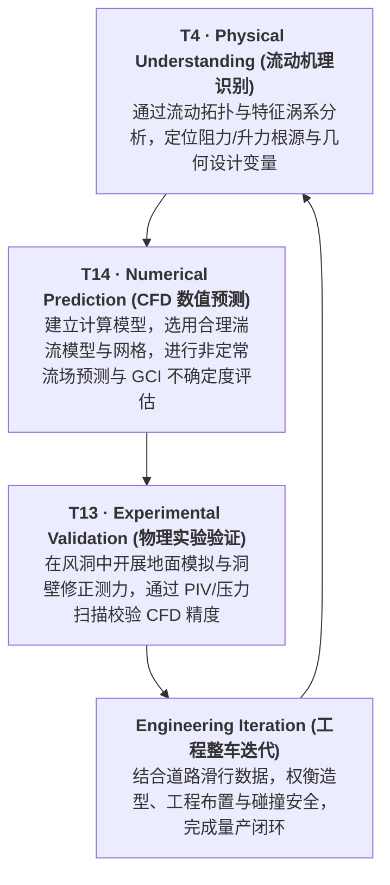

# 汽车空气动力学 · 180 节全书课程大纲地图 (v5.2-Freeze)

- **版本**：v5.2-Freeze（正式冻结版 · 经原书目录核验、P0/P1 全项闭环修正）
- **依据**：Hucho《Aerodynamics of Road Vehicles》5th ed.，Docling 结构化提取库（正文 22–1195 页，共 1,174 页，650 个精准节次匹配）
- **课程规模总账**：
  - **总集数**：严格等于 **180 节**
  - **总时长**：严格核准为 **2,006 分钟**（原初估算 1,944 → 冻结核准 2,004 → 2026-11-20 T1-05 由 9 min 调整为 10 min）
  - **单节平均时长**：**11.14 分钟**（弹性区间：8.0 – 16.0 分钟）
  - **折合工业标准学时**：**33.4 小时**（按 60 分钟/标准工业课时核算）
  - **折合高校教学学时**：**44.58 学时**（按高校 45 分钟/学时核算）
- **工程开发主轴**：
  $$\text{T4 Physical Understanding (机理识别)} \longrightarrow \text{T14 Numerical Prediction (CFD预测)} \longrightarrow \text{T13 Experimental Validation (实验验证)} \longrightarrow \text{Engineering Iteration (工程迭代)}$$

```yaml curriculum
course: automotive-aerodynamics
version: 5.2-Freeze
modules:
  - {id: T1,  chapter: 1,  name: "绪论与汽车气动史", count: 5,  minutes: 47}
  - {id: T2,  chapter: 2,  name: "流体力学物理与数学原理", count: 19, minutes: 224}
  - {id: T3,  chapter: 3,  name: "行车动力学与能耗敏度", count: 6,  minutes: 60}
  - {id: T4,  chapter: 4,  name: "乘用车气动力与流场机理", count: 38, minutes: 436}
  - {id: T5,  chapter: 5,  name: "气动特性与高速操纵稳定性", count: 10, minutes: 114}
  - {id: T6,  chapter: 6,  name: "功能、安全与气动环境舒适性", count: 7,  minutes: 73}
  - {id: T7,  chapter: 7,  name: "冷却系统与机舱内流阻力", count: 6,  minutes: 68}
  - {id: T8,  chapter: 8,  name: "汽车气动声学与风噪机理", count: 6,  minutes: 69}
  - {id: T9,  chapter: 9,  name: "高性能跑车与赛车气动力学", count: 15, minutes: 168}
  - {id: T10, chapter: 10, name: "商用车与重型卡车气动力学", count: 12, minutes: 128}
  - {id: T11, chapter: 11, name: "摩托车气动力学", count: 10, minutes: 103}
  - {id: T12, chapter: 12, name: "骑手头盔气动力学与声学", count: 4,  minutes: 40}
  - {id: T13, chapter: 13, name: "汽车风洞试验与测量技术", count: 18, minutes: 206}
  - {id: T14, chapter: 14, name: "汽车空气动力学 CFD 数值仿真", count: 24, minutes: 270}
```

---

## 1. 课程知识结构分布与学时比例

```
                                180 节课程知识结构分布
┌─────────────────────────────────────────────────────────────────────────────┐
│ 【理论基石】 T2 流体力学与数学原理 (19 节 · 10.6% · 224 min)                    │
├─────────────────────────────────────────────────────────────────────────────┤
│ 【整车气动与工程应用】 T1, T3–T8 (77 节 · 42.8% · 867 min)                    │
│  - T1 绪论 (5)  · T3 动力学能耗 (6) · T4 乘用车机理 (38)                      │
│  - T5 操稳 (10) · T6 功能防污 (7)  · T7 冷却内流 (6) · T8 声学风噪 (6)        │
├─────────────────────────────────────────────────────────────────────────────┤
│ 【特殊车型与竞速竞技】 T9–T12 (41 节 · 22.8% · 439 min)                       │
│  - T9 赛车与超跑 (15) · T10 商用车重卡 (12) · T11 摩托车 (10) · T12 头盔 (4)  │
├─────────────────────────────────────────────────────────────────────────────┤
│ 【工程预测与物理验证】 T13–T14 (42 节 · 23.3% · 476 min)                      │
│  - T14 CFD 数值预测 (24 节) · T13 风洞试验验证 (18 节)                        │
└─────────────────────────────────────────────────────────────────────────────┘
  总时长合计：47 + 224 + 60 + 436 + 114 + 73 + 68 + 69 + 168 + 128 + 103 + 40 + 206 + 270 = 2,006 min
```

---

## 2. 核心教学闭环与工程方法论规范

### 2.1 贯穿主轴：汽车空气动力学工业开发闭环


### 2.2 T2 理论推导与汽车工程落地映射表（避免纯数学孤立）

| 基础数理章节 | 核心推导内容 | 汽车工程落地锚点（解决什么实际问题？） |
| :--- | :--- | :--- |
| **T2-04** | Bernoulli 方程与总压守恒 | 车身迎风驻点高压计算、前脸驻点位置标定、发动机进气总压恢复 |
| **T2-06** | Navier-Stokes 方程项分解 | 解释车身近壁面粘性扩散项与外部流场对流加速度项的量级平衡 |
| **T2-10/11** | 环量、Kutta-Joukowski 定理与涡量动力学 | 解释赛车倒置翼型下压力来源、车身侧窗 A 柱脱体涡与 C 柱纵向诱导涡 |
| **T2-14/15** | Prandtl 边界层方程与 Blasius 相似解 | 平整底盘与前机盖层流边界层摩擦阻力基线计算、无量纲厚度尺度评定 |
| **T2-16** | 冯·卡门动量积分方程与排挤/动量厚度 | 车顶气流流经曲率变化时边界层厚度增长计算、车身附面层控制基准 |
| **T2-17** | 逆压梯度与边界层分离物理判据 | 阶背车后风挡气流分离、Ahmed 标体尾部失速泡形成的数理根源 |
| **T2-18** | 边界层湍流转捩与圆球阻力危机 | 解释旋转车轮与粗糙底盘为何需要人工触发湍流以推迟大范围分离 |

### 2.3 T14 CFD 算法工程决策矩阵（拒绝万能模型幻觉）

| 数值方法 / 模型 | 核心解决问题 | 主要计算成本与误差来源 | 工业工程推荐使用场景 |
| :--- | :--- | :--- | :--- |
| **LBM (格子玻尔兹曼)** | 极脏 CAD 几何免修面自动化网格划分 | 内存占用巨大，近壁面高雷诺数解析成本高 | 造型初期极速气动评估、整车全细节快速迭代 |
| **RANS (SST k-ω)** | 逆压梯度下附着流与微小分离预测 | 无法准确捕捉高度非定常脱落涡；**非万能模型** | 常规乘用车中低速巡航稳态外流场与定常阻力优化 |
| **LES (大涡模拟)** | 空间大尺度非定常涡街完全直接解析 | 网格量达数亿，近壁棱柱层计算开销无法承受 | 局部高精度流动研究、A柱/后视镜瞬态高频风噪源分析 |
| **DES / DDES** | 兼顾近壁边界层效率与尾流非定常精度 | 灰区（Grey Area）延迟分离伪网格诱导分离 | 整车尾流大范围死水区分离模拟、Ahmed/DrivAer 标体仿真 |
| **GCI (网格收敛指标)** | 消除“网格越细阻力越对”的主观猜想 | 需计算粗/中/细三套网格，总计算时长增加 2 倍 | 关键决策节点、阻力系数法向收敛不确定度定量评定 |

### 2.4 T13 实验测量不确定度与可信度原则

在风洞与实验教学中，坚决树立**“测出一个数字不等于真实值”**的工程意识：
1. **天平解耦不确定度**：六分力应变天平存在非线性轴间串扰，需标定解耦矩阵 $[C]_{6\times 6}$，注意升阻比极高/极低时的灵敏度误差。
2. **洞壁阻塞修正误差**：闭口风洞 Maskell 修正与 Thom 方法均基于一维收缩假定，当模型阻塞比 $> 5\%$ 或处于大分离态时存在经验模型偏差。
3. **地面效应模拟误差**：静止地板存在假附面层；移动带系统在带边缘处存在剪切缝隙漏气，旋转车轮接触区喷射流与真实路面存在微小几何间隙。
4. **道路滑行转换误差**：道路试验受环境风速、阵风风偏角、路面宏观粗糙度与轮胎温度动态影响，需通过标准算法（如 SAE J1263 / ISO 10521）过滤环境随机噪声。

### 2.5 Claim–Evidence 来源属性与工程经验数值适用条件

- **四类来源属性标注**：
  - `[B] Book-based`：Hucho 原书直接支持（166 节）
  - `[C] Cross-chapter synthesis`：跨章节逻辑整合（2 节）
  - `[E] Engineering extension`：现代工程实践补充（4 节）
  - `[M] Modern update`：2015 之后最新工程技术（8 节）
- **工程经验数值适用条件声明**：
  大纲中所引用的关键工程数据（如 CMS 减阻 $\Delta C_D \approx 0.005$、扩散器扩张角 8°–12°、卡车尾板减阻 0.04–0.06、机舱冷却阻力 8%–12% 等），**严禁当作无条件普适物理常数**，讲授时必须明确其车型基准、测试条件与雷诺数范围。

---

## 3. 180 节逐集详细对标表 (v5.2-Freeze 全量核准)

### T1: 绪论与汽车气动史（5 集 · 47 min）

| 集号 | 标题 | 原书节次 | 原书物理页 | 来源属性 | 建议时长 | 核心教学内容与知识点 |
| :--- | :--- | :---: | :---: | :---: | :---: | :--- |
| T1-01 | 汽车为什么本质上是钝体流动问题？ | 1.1 | p.22–27 | `[B]` | 10 min | 钝体流动的本质：大范围边界层分离、逆压梯度与压差阻力主导机理 |
| T1-02 | 阻力系数 c_D 与功率三次方：汽车气动的经济账本 | 1.2.3 | p.31–32 | `[B]` | 9 min | $F_D = \frac{1}{2}\rho v^2 C_D A$ 与克服风阻功率 $P_{aero} \propto v^3$ 物理意义 |
| T1-03 | 流线型探索百年：从飞艇仿形到半体理论的经验与教训 | 1.2.5–1.2.6 | p.33–46 | `[B]` | 9 min | 早期空中飞艇对称形体移植到近地面的失误，半体（Half-body）气动形态诞生 |
| T1-04 | 车身一体化成型与现代气动造型分类学 | 1.3–1.4 | p.47–60 | `[B]` | 9 min | 阶背车（Notchback）、快背车（Fastback）与平头两厢（Squareback）分离线差异 |
| T1-05 | 现代汽车气动工程的核心矛盾与系统开发闭环 | 1.9 & 1.11 | p.70–95 | `[C]` | 10 min | 造型美学、乘员空间、碰撞安全与气动低风阻的工程妥协与整车闭环 |

### T2: 流体力学物理与数学原理（19 集 · 224 min）——单节消化单项推导

| 集号 | 标题 | 原书节次 | 原书物理页 | 来源属性 | 建议时长 | 核心教学内容与推导任务 |
| :--- | :--- | :---: | :---: | :---: | :---: | :--- |
| T2-01 | 连续介质假定与速度场的运动学描述 | 2.1.1–2.1.2 | p.96–101 | `[B]` | 11 min | Knudsen 数极限、控制体微元与速度场散度 $\nabla \cdot \vec{v}$ 物理意义 |
| T2-02 | 流线、迹线与不可压缩流动连续性微分方程 | 2.1.2.3–2.1.3 | p.101–103 | `[B]` | 11 min | 流线微分方程 $dx/u = dy/v = dz/w$ 与不可压缩连续性方程 $\nabla \cdot \vec{v} = 0$ 推导 |
| T2-03 | 无粘动量守恒：Euler 方程的严格推导 | 2.1.4 | p.103–104 | `[B]` | 12 min | 流体质点受压强梯度力与重力作用，推导 Euler 动量方程 $\rho \frac{D\vec{v}}{Dt} = -\nabla p + \rho\vec{g}$ |
| T2-04 | 沿流线的积分：Bernoulli 方程的物理机制与适用边界 | 2.1.5 | p.104–105 | `[B]` | 10 min | 定常无粘流沿流线积分推导 $p + \frac{1}{2}\rho v^2 = p_0$ 及其车身驻点压强应用边界 |
| T2-05 | 势流理论基础：速度势与流函数的拉普拉斯方程 | 2.1.6 | p.105–106 | `[B]` | 11 min | 无旋场 $\nabla \times \vec{v} = 0$ 引入速度势 $\Phi$，连续性导出拉普拉斯方程 $\nabla^2 \Phi = 0$ |
| T2-06 | 真实流体粘性应力与 Navier-Stokes 方程完整拆解 | 2.1.7 | p.106–109 | `[B]` | 14 min | 变形率张量 $S_{ij}$、牛顿流体粘性应力 $\tau_{ij}$ 及 NS 方程各项（非定常/对流/压力/粘性）深度推导 |
| T2-07 | 积分形式的守恒定律与控制体雷诺输运定理 | 2.1.8.1–2.1.8.5 | p.109–114 | `[B]` | 13 min | 高斯散度定理，控制体动量定理推导远场阻力与动量亏损积分方程 |
| T2-08 | 基本平流场与奇点叠加：点源、点汇与偶极子 | 2.2.1–2.2.2.1 | p.114–120 | `[B]` | 11 min | 均匀流叠加偶极子解析解，流函数 $\Psi$ 表达圆柱绕流流场形态 |
| T2-09 | 理想流体圆柱绕流与达朗贝尔佯谬（D'Alembert Paradox） | 2.2.2.3 | p.120–126 | `[B]` | 11 min | 理想无粘势流表面对称压力分布积分导致 $C_D = 0$ 的经典佯谬机理剖析 |
| T2-10 | 环量、Kutta-Joukowski 升力定理与 Magnus 效应 | 2.2.2.4 | p.126–128 | `[B]` | 12 min | 环量 $\Gamma = \oint \vec{v} \cdot d\vec{r}$，二维环量与升力定理 $L' = \rho_\infty V_\infty \Gamma$ 推导 |
| T2-11 | 涡量动力学：涡量方程与 Helmholtz 涡线保持定理 | 2.2.3.1 | p.128–130 | `[B]` | 12 min | 涡量 $\vec{\omega} = \nabla \times \vec{v}$ 输运方程，三维涡线拉伸与倾斜机制 |
| T2-12 | 涡丝诱导速度：Biot-Savart 定律与三维脱体涡系统 | 2.2.3.2 | p.130–132 | `[B]` | 12 min | Biot-Savart 定律微分积分形式，诱导下洗（Downwash）速度场计算 |
| T2-13 | 雷诺数物理本质与流动动力相似律准则 | 2.3.1 | p.132–133 | `[B]` | 10 min | 惯性力与粘性力比值 $Re = \rho U L / \mu$，无量纲 NS 方程尺度量级分析 |
| T2-14 | Prandtl 附面层理论与尺度量级分析 | 2.3.2 | p.133–136 | `[B]` | 13 min | 高雷诺数下粘性集中于极薄壁面层 $\delta/L \sim Re^{-1/2}$，边界层方程导出 |
| T2-15 | 层流边界层相似性解：Blasius 精确解推导与剪切应力 | 2.3.2 | p.134–136 | `[B]` | 13 min | 引入相似变量 $\eta = y\sqrt{U/(\nu x)}$（明确根号及分母范围），将偏微分方程降阶为 Blasius 非线性常微分方程 |
| T2-16 | 边界层动量积分关系：冯·卡门动量积分方程 | 2.3.2 | p.136 | `[B]` | 13 min | 排挤厚度 $\delta^*$ 与动量损失厚度 $\theta$ 定义，推导 $\frac{d\theta}{dx} + \frac{\theta}{U}\frac{dU}{dx}(2+H) = \frac{\tau_w}{\rho U^2}$ |
| T2-17 | 逆压梯度与流动分离物理判据 | 2.3.3 | p.136–139 | `[B]` | 12 min | 逆压梯度 $dp/dx > 0$ 下壁面速度拐点失稳与分离点判据 $(\partial u/\partial y)_{y=0} = 0$ |
| T2-18 | 边界层湍流转捩、雷诺应力与圆球阻力危机 | 2.3.4–2.3.5.3 | p.139–150 | `[B]` | 12 min | 层流向湍流转捩，湍流边界层抗分离能力，临界雷诺数下阻力陡降 80% 机理 |
| T2-19 | 多体系统气动干扰与地面镜像法 | 2.3.6 | p.152–155 | `[B]` | 11 min | 刚性壁面边界条件下的镜像偶极子与镜像涡，近地间隙流动加速与收缩 |

### T3: 行车动力学与能耗敏度（6 集 · 60 min）

| 集号 | 标题 | 原书节次 | 原书物理页 | 来源属性 | 建议时长 | 核心教学内容与知识点 |
| :--- | :--- | :---: | :---: | :---: | :---: | :--- |
| T3-01 | 整车纵向行驶阻力平衡方程与阻力分界点 | 3.1–3.2.1 | p.172–177 | `[B]` | 10 min | 滚动阻力 $F_{roll}$ 与气动阻力 $F_{aero}$ 等值交叉速度点（乘用车典型 60–80 km/h） |
| T3-02 | 克服风阻所需的发动机/电机功率三次方程 | 3.2.2 | p.177–181 | `[B]` | 10 min | 克服气动阻力功率 $P = \frac{1}{2}\rho C_D A v^3$，车速从 100 提至 120 km/h 功率飙升 73% 计算 |
| T3-03 | 车辆加速、爬坡与最高车速的气动灵敏度 | 3.3 | p.181–186 | `[B]` | 10 min | 最高车速由驱动功率与风阻功率交点决定，外形迎风面积与 $C_D$ 敏度导数 |
| T3-04 | 道路滑行测试（Coastdown）与阻力多项式拟合 | 3.4 | p.186–191 | `[B]` | 10 min | 滑行测试减速度 $dv/dt$ 积分，目标载荷三次项拟合 $F(v) = f_0 + f_1 v + f_2 v^2$ |
| T3-05 | 能耗认证循环：从 NEDC、WLTP 到 CLTC 的风阻敏度差异 | 3.5 | p.191–198 | `[M]` | 10 min | 欧洲 WLTP 高速工况占比高 vs 中国 CLTC 低速工况占比大对气动减阻收益的定量评估 |
| T3-06 | 纯电动汽车（BEV）高速续航对 c_D 的边际敏度分析 | 3.6–3.7 | p.198–217 | `[E]` | 10 min | 电池容量、驱动电机效率与 $\Delta C_D = -0.01$ 在 120km/h 巡航下兑现续航里程换算模型 |

### T4: 乘用车气动力与流场机理（38 集 · 436 min）——工程主轴一

| 集号 | 标题 | 原书节次 | 原书物理页 | 来源属性 | 建议时长 | 核心教学内容与知识点 |
| :--- | :--- | :---: | :---: | :---: | :---: | :--- |
| T4-01 | 汽车六分力与力矩坐标系及其工程物理意义 | 4.1 | p.222–227 | `[B]` | 10 min | SAE/ISO 坐标系：阻力 $F_D$、升力 $F_L$、侧向力 $F_S$、俯仰/横摆/侧倾力矩物理意义 |
| T4-02 | 车身表面压强积分与摩擦阻力的空间贡献率 | 4.2 | p.227–229 | `[B]` | 11 min | 表面闭合积分公式；标明典型乘用车压差阻力约 70%–80%，摩擦阻力约 15%–20%（非普适常数） |
| T4-03 | 汽车钝体死水区与非定常尾流剪切层失稳 | 4.2.1 | p.229–236 | `[B]` | 11 min | 自由剪切层 Kelvin-Helmholtz 失稳，大尺度回流区与背压亏损机理 |
| T4-04 | 空间纵向涡系统：A柱涡、C柱涡与底板涡的生成拓扑 | 4.2.2 | p.236–237 | `[B]` | 12 min | 气流绕过斜置棱边滚动形成空间纵向涡（Longitudinal Vortices），低压涡核效应 |
| T4-05 | 汽车绕流中的内部流动与环境影响因子 | 4.2.3–4.2.4 | p.237–240 | `[B]` | 10 min | 冷却进风与通风外泄对外部绕流干扰，环境侧风与大气湍流的影响 |
| T4-06 | 汽车实际运行中的雷诺自模化现象 | 4.2.5 | p.240–241 | `[B]` | 10 min | 锐边钝体在 $Re > 10^6$ 后的气动阻力系数自模化（Reynolds Number Independence） |
| T4-07 | 气动阻力的物理分解：摩擦、压差、诱导与内流阻力 | 4.3.1 | p.241–244 | `[B]` | 11 min | 乘用车阻力四大物理成分解耦模型与控制策略 |
| T4-08 | 尾流能量损失与总压损失面测阻积分（Wake Survey） | 4.3.2 | p.244–247 | `[B]` | 12 min | Betz-Troller 尾流积分公式，尾流平面五孔探针与 PIV 动压损失重构阻力 |
| T4-09 | 汽车气动升力与三维下洗诱导阻力生成机理 | 4.3.3.1 | p.247–254 | `[B]` | 11 min | 车身不对称外形产生净升力，尾部下洗流使气动力向后倾斜产生诱导阻力 |
| T4-10 | 冷却空气流阻抗、表面粗糙度与零部件干扰阻力 | 4.3.3.2 | p.254–267 | `[B]` | 11 min | 机舱冷却阻力在典型车型中占约 8%–12%（标明工况），附件缝隙与粗糙度干扰阻力叠加 |
| T4-11 | 侧向力、横摆力矩与侧倾力矩的物理来源 | 4.4 | p.267–271 | `[B]` | 10 min | 偏航角 $\beta$ 下车身迎风面与背风面非对称压力场积分 |
| T4-12 | 前保驻点位置、机盖倾角与迎面气流分流拓扑 | 4.5.1.1 | p.274–286 | `[B]` | 12 min | 前脸驻点高度对上下分流比控制，机盖前缘倒角曲率半径防分离标准 |
| T4-13 | 前下唇板（Front Air Dam）对前桥升力与总阻力的控制 | 4.5.1.1.2 | p.286–287 | `[B]` | 11 min | 阻挡高动压气流进入底盘，在车头下方形成低压区消除前轴抬升力 |
| T4-14 | 前风挡倾角变化与前风挡上沿流动分离机理 | 4.5.1.2.1 | p.287–291 | `[B]` | 11 min | 风挡倾角 $\alpha$ 从 30° 到 60° 阻力饱和曲线，风挡上沿再附着分离泡控制 |
| T4-15 | A 柱截面曲率半径、水槽凹陷与侧窗前缘贴附流 | 4.5.1.2.2 | p.291–294 | `[B]` | 12 min | A 柱半径扩大防止侧面气流锐角剥离，消除强 A 柱涡对侧窗风噪冲击 |
| T4-16 | 车顶拱度、纵向曲率变化与车身下倾线设计 | 4.5.1.2.3 | p.294–301 | `[B]` | 11 min | 车顶前部顺压加速区与后部逆压恢复区设计，防止车顶最高点过早分离 |
| T4-17 | 经典两厢车（Squareback）尾流拓扑与环形剪切层 | 4.5.1.3.1 | p.303–311 | `[B]` | 12 min | 平头两厢车封闭环形剪切层与尾门大面积极低压区形成机理 |
| T4-18 | 阶背车（Notchback）的后窗分离与行李箱盖再附着 | 4.5.1.3.2 | p.311–316 | `[B]` | 12 min | 三厢车后风挡斜度、行李箱高度与长度三参数耦合，后盖气流再附着判定 |
| T4-19 | **【工程主轴节点】Ahmed 标体临界后倾角（30° 阻力突变）** | 4.5.1.3.2 | p.316–318 | `[B]` | 14 min | 明确强调：30° 是特定 Ahmed 几何下的临界跳跃角，非所有车型普适常数；解析纵向涡向全失速转变 |
| T4-20 | 后风挡倾角 12°–30° 之间 C 柱纵向涡能量汇聚机理 | 4.5.1.3.2 | p.318–321 | `[B]` | 12 min | 侧向气流向后窗卷吸汇聚，强涡核低压抽吸导致后窗产生巨大诱导阻力 |
| T4-21 | 尾部侧围向内收缩（Boat-tailing）对尾流死水区压力的恢复 | 4.5.1.3.3 | p.321–325 | `[B]` | 11 min | 车身侧围向后收缩最佳角度（典型 12°–15°），减小尾部截面积提升背压 |
| T4-22 | 行李箱后缘锐边（Spoiler Edge）强制固定分离线作用 | 4.5.1.3.4 | p.325–332 | `[B]` | 11 min | 消除后下圆角边界层粘滞上爬现象，固定尾部分离线以削减气动升力 |
| T4-23 | 汽车尾翼的气动迎角、阻力惩罚与下压力平衡 | 4.5.1.3.5 | p.332–340 | `[B]` | 12 min | 倒置翼型在尾部非均匀流场中的有效迎角设定，后轴下压力与 $C_D$ 折中 |
| T4-24 | 进气格栅阻抗与内部冷却流阻力贡献率 | 4.5.2.1 | p.342–348 | `[B]` | 11 min | 格栅开口面积率与内流动量损失模型，冷却风阻估算与风阻惩罚 |
| T4-25 | 主动进气格栅（AGS）的控制逻辑与气动节油率 | 4.5.2.2 | p.348–355 | `[E]` | 10 min | 开度与发动机/电池水温闭环控制，全闭状态在特定中型轿车带来 $\Delta C_D \approx 0.015$–$0.025$ 收益 |
| T4-26 | 平整底护板对底部边界层厚度与压差的重构 | 4.5.3.1 | p.355–364 | `[B]` | 12 min | 消除底盘悬架排气凸凹湍流耗散，全平整底护板重构底部附面层与压差 |
| T4-27 | 离地间隙（Ride Height）与整车俯仰角的气动敏感性 | 4.5.3.2 | p.364–367 | `[B]` | 11 min | 离地间隙降低增强底盘文丘里抽吸，前低后高前俯角（Rake）降低阻力 |
| T4-28 | 尾部扩散器（Diffuser）扩张角与压力恢复抽吸效应 | 4.5.3.2.3 | p.367–370 | `[B]` | 13 min | 标明扩散器无分离最佳扩张角典型为 8°–12°（受底板边界层状态与上游间隙制约） |
| T4-29 | 孤立旋转车轮的流动分离与轮辐气动损失 | 4.5.3.3.1 | p.370–376 | `[B]` | 12 min | 车轮接地点前向喷射流（Jetting Effect），轮顶逆向转动诱发大范围分离 |
| T4-30 | 轮腔内湍流混合与前后轮前导流板（Spats）减阻 | 4.5.3.3.2 | p.376–380 | `[B]` | 11 min | 轮前小导流板偏转底部气流，避免气流正面撞击轮胎迎风侧胎面 |
| T4-31 | 前轮气帘（Air Curtain）导流与轮侧尾迹偏转机理 | 4.5.3.3.3 | p.380–382 | `[E]` | 11 min | 前保侧进风道喷射高速薄气层，平顺推开前轮湍流脱落尾迹 |
| T4-32 | 外后视镜的气动阻力构成与尾迹对侧窗的撞击 | 4.5.3.4.1 | p.382–386 | `[B]` | 11 min | 外后视镜镜壳、镜臂及镜座流场阻力分解（占整车阻力典型 3%–6%） |
| T4-33 | 电子外后视镜（CMS）的气动减阻收益与工程边界 | 4.5.3.4.2 | p.386–388 | `[M]` | 11 min | 截面积缩小 60% 带来 $\Delta C_D \approx 0.005$ 收益（标明参考车型）与视野法规要求 |
| T4-34 | 雨刷、门缝、车门把手微小缝隙引起的干扰阻力 | 4.5.3.5 | p.388–395 | `[B]` | 11 min | 隐藏式门把手、齐平式侧窗水切与雨刷隐藏带来的微气动减阻收益 |
| T4-35 | 乘用车编队行驶（Platooning）与跟车间距气动互扰 | 4.5.4.1 | p.395–398 | `[B]` | 12 min | 前车尾流推力效应与后车吸力效应，最佳跟车间距与减阻能耗比 |
| T4-36 | 会车与超车过程中的瞬态侧向力突变机理 | 4.5.4.3 | p.398–401 | `[B]` | 12 min | 两车侧向近距离交会时高压头碰撞与低压侧吸动态演化过程 |
| T4-37 | 乘用车整车气动正向开发流程与 CAS 面工程冻结 | 4.6.1 | p.401–409 | `[B]` | 13 min | 气动架构概念期、1:4 模型阶段、CAS 造型面迭代与生产模具冻结节点 |
| T4-38 | **【工程主轴节点】三大标准参考体：Ahmed、SAE 与 DrivAer** | 4.9 | p.427–433 | `[B]` | 15 min | 现代基准模型 DrivAer（含快背/三厢/旅行版）几何定义与全球公开数据库（CFD/风洞对标总载体） |

### T5: 气动特性与高速操纵稳定性（10 集 · 114 min）

| 集号 | 标题 | 原书节次 | 原书物理页 | 来源属性 | 建议时长 | 核心教学内容与知识点 |
| :--- | :--- | :---: | :---: | :---: | :---: | :--- |
| T5-01 | 汽车高速直行稳定性与气动六分力动态耦合 | 5.1.1 | p.435–437 | `[B]` | 11 min | 准定常假设与侧向力、横摆力矩对高速直线行驶轨迹偏移的耦合激励 |
| T5-02 | 大气自然侧风边界层与湍流阵风功率谱 | 5.1.2.1 | p.437–448 | `[B]` | 11 min | 近地面风剪切对数分布剖面，Von Kármán 阵风湍流能量谱特征 |
| T5-03 | 阵风发生器（Gust Generator）与风洞瞬态侧风模拟 | 5.1.2.2 | p.448–455 | `[B]` | 12 min | 旋转开槽叶片与侧向瞬态脉冲喷管物理复现道路阶跃阵风与正弦阵风 |
| T5-04 | **【公式与内容补全】车辆气动导纳函数与频域传递特性** | 5.1.2.2 | p.455–466 | `[B]` | 12 min | 气动导纳定义 $S_F(\omega) = \|A_F(\omega)\|^2 (2\bar{F}/\bar{U})^2 S_u(\omega)$；车身低通滤波特性；准定常假设极限 ($k = \omega L / 2U \ll 1$)；解释为何相同平均风速下高频阵风被车身几何自然平滑 |
| T5-05 | 侧风激励下的单轨汽车动力学二自由度方程 | 5.2.1 | p.466–470 | `[B]` | 13 min | 横向位移 $y$ 与横摆角速度 $r$ 动力学状态空间方程，侧向风压输入响应求解 |
| T5-06 | 气动升力对轮胎垂直载荷及侧偏刚度的削弱机理 | 5.2.2 | p.470–480 | `[B]` | 12 min | 轮胎摩擦附着椭圆理论，高速气动升力降低法向压紧力导致极限抓地力断崖 |
| T5-07 | 前后轴气动升力平衡分配对转向不足特性的修正 | 5.2.3 | p.480–482 | `[B]` | 11 min | 前后轴升力比 $\Delta C_{Lf} / \Delta C_{Lr}$ 对高速过弯转向不足度（Understeer Gradient）的调定 |
| T5-08 | 压力中心（Center of Pressure）与整车质心相对位置法则 | 5.2.4.1 | p.482–485 | `[B]` | 12 min | 严格定义整车坐标系与力矩符号：气动侧向压力中心位于质心之后时产生自然恢复力矩的被动稳定判据 |
| T5-09 | 偏航角变化下侧向风压中心移动轨迹与横摆稳定性 | 5.2.4.2 | p.485–490 | `[B]` | 10 min | 偏航角 $\beta$ 从 0° 到 30° 侧向压力中心非线性漂移曲线与失稳临界点 |
| T5-10 | 驾驶员闭环响应、ESP 与后轮主动转向侧风补偿 | 5.2.4.3 | p.490–493 | `[E]` | 10 min | 毫秒级检测横摆角速度，ESP 单侧制动与后轮线控小转角侧风补偿控制闭环 |

### T6: 功能、安全与气动环境舒适性（7 集 · 73 min）

| 集号 | 标题 | 原书节次 | 原书物理页 | 来源属性 | 建议时长 | 核心教学内容与知识点 |
| :--- | :--- | :---: | :---: | :---: | :---: | :--- |
| T6-01 | 高速气动载荷引起的外覆盖件变形与颤振 | 6.1.1–6.1.2 | p.495–501 | `[B]` | 10 min | 机盖前沿负压上吸变形、车门上框负压外吸漏风与外后视镜气动颤振 |
| T6-02 | 高速行驶下风窗雨刷浮起机理与气动下压力设计 | 6.1.3 | p.501–508 | `[B]` | 11 min | 雨刷臂与胶条截面非对称导流翼型，高速气流产生气动负升力压紧风挡 |
| T6-03 | 敞篷车座舱剪切层卷吸与座舱热舒适气动挡板 | 6.2.1–6.2.4 | p.508–522 | `[B]` | 11 min | 前风挡顶缘脱体剪切层向座舱后部卷吸，后挡风网板（Wind deflector）破涡 |
| T6-04 | 天窗低频空腔轰鸣（Buffeting）与锯齿扰流板降噪 | 6.2.6 | p.522–524 | `[B]` | 11 min | Helmholtz 亥姆霍兹共振腔自激振荡机理，天窗前缘锯齿扰流条剪切层破碎 |
| T6-05 | 雨滴与水相粒子在车身表面的流动轨迹与附着 | 6.3.1 | p.524–544 | `[B]` | 11 min | 欧拉-拉格朗日多相流模型，雨水撞击前风挡后的横向爬移与 A 柱水槽导流 |
| T6-06 | 旋转车轮甩水与侧窗/后视镜区域自诱导污染 | 6.3.3 | p.544–547 | `[B]` | 9 min | 轮腔高压外喷水雾在侧围负压区的卷吸沉降与视线遮挡机理 |
| T6-07 | 自动驾驶传感器（激光雷达/摄像头）气动防污冲刷 | 6.3.3 扩展 | p.547 | `[M]` | 10 min | 车顶激光雷达凸起流场分离控制，气动喷气吹扫与被动防污流罩集成（现代扩展） |

### T7: 冷却系统与机舱内流气动阻力（6 集 · 68 min）

| 集号 | 标题 | 原书节次 | 原书物理页 | 来源属性 | 建议时长 | 核心教学内容与知识点 |
| :--- | :--- | :---: | :---: | :---: | :---: | :--- |
| T7-01 | 整车极端工况热平衡：动力系统负荷与空调热负荷分解 | 7.1 | p.548–553 | `[B]` | 10 min | 明确分开阐述：满载挂车高温爬坡/极速巡航（动力热负荷）与怠速暴晒全开（座舱空调热负荷） |
| T7-02 | 换热器流动阻力特性与多孔介质压降模型 | 7.2.1 | p.553–558 | `[B]` | 12 min | Darcy-Forchheimer 方程 $\Delta p / L = \frac{\mu}{\alpha} v + C_2 \frac{1}{2}\rho v^2$ 压损二次曲线拟合 |
| T7-03 | 机舱内部空间紧凑布置与冷却空气流动阻抗 | 7.2.4 | p.558–562 | `[B]` | 11 min | 冷凝器、散热器、中冷器串联层叠阻力，机舱内部绕流流动阻抗网络计算 |
| T7-04 | 冷却风扇 P-Q 性能曲线与整车系统阻抗匹配 | 7.3 | p.562–568 | `[B]` | 12 min | 风机扬程-流量特性曲线与系统流动阻抗曲线相交工作点（Operating Point）推演 |
| T7-05 | 机舱排气口位置、机舱底护板与出流动量损失 | 7.4–7.5 | p.568–589 | `[B]` | 12 min | 底盘下部负压区引导出风，减少机舱排气对底盘平整流场的流动破坏与测压 |
| T7-06 | 新能源电动汽车热管理系统与低风阻前端集成 | 7.1 扩展 | p.589 | `[M]` | 11 min | 纯电架构取消大进气口后，电池底板水冷、热泵与主动式进气集成气动优化 |

### T8: 汽车气动声学与风噪机理（6 集 · 69 min）

| 集号 | 标题 | 原书节次 | 原书物理页 | 来源属性 | 建议时长 | 核心教学内容与知识点 |
| :--- | :--- | :---: | :---: | :---: | :---: | :--- |
| T8-01 | 气动噪声源分类：单极子、偶极子与四极子物理特征 | 8.1 | p.590–595 | `[B]` | 12 min | 质量变动单极子 $p \propto u^4$、壁面脉动力偶极子 $p \propto u^6$、湍流剪切四极子 $p \propto u^8$ 辐射规律 |
| T8-02 | Lighthill 声学类比理论与 Curle 表面压力脉动积分方程 | 8.2 | p.595–602 | `[B]` | 13 min | Lighthill 声波波动方程展开，Curle 固壁边界偶极子远场声压积分公式推导 |
| T8-03 | 声学风洞背景噪声控制与无回响壁面设计 | 8.3.1 | p.602–604 | `[B]` | 11 min | 全消声室吸波尖劈（Cut-off 频率），风机低速大叶片静音设计指标 |
| T8-04 | 麦克风阵列波束形成（Beamforming）声源空间定位 | 8.3.5 | p.604–608 | `[B]` | 12 min | 螺旋阵列延迟求和（Delay-and-Sum）波束形成算法，空间声源云图重构 |
| T8-05 | A 柱涡破裂与外后视镜脱体涡风噪抑制工程对策 | 8.4 | p.608–615 | `[B]` | 11 min | A 柱脱体涡破碎引起的侧窗非定常表面压力脉动抑制，双层隔音玻璃隔声量 |
| T8-06 | 汽车侧窗隔声量与纯电动车高频风噪心理声学评价 | 8.5 | p.615–621 | `[B]` | 10 min | 响度（Sone）、粗糙度（Roughness）、尖锐度（Sharpness）风品质评价体系 |

### T9: 高性能跑车与赛车气动力学（15 集 · 168 min）

| 集号 | 标题 | 原书节次 | 原书物理页 | 来源属性 | 建议时长 | 核心教学内容与知识点 |
| :--- | :--- | :---: | :---: | :---: | :---: | :--- |
| T9-01 | 赛车空气动力学的终极目标：下压力与轮胎抓地力 | 9.1 | p.622–623 | `[B]` | 10 min | 轮胎摩擦椭圆下垂直载荷与最大过弯侧向加速度极限 $a_y = \mu (m g + F_{down}) / m$ |
| T9-02 | 极速纪录车与公路超跑的极端减阻设计权衡 | 9.2 | p.623–644 | `[B]` | 10 min | 极速车极小迎风面积与长锥尾形态 vs 赛道超跑下压力优先权衡 |
| T9-03 | 现代方程式赛车与原型车气动规则体系演变 | 9.3–9.4 | p.644–656 | `[B]` | 10 min | FIA 规则对底板、尾翼、扩散器尺寸边界的立法限制与漏洞博弈 |
| T9-04 | 气动效率与升阻比（L/D）在不同赛道特性下的优化 | 9.6.1 | p.656–664 | `[B]` | 12 min | 摩纳哥高下压力套件 vs 蒙扎低阻力套件的升阻比折中计算模型 |
| T9-05 | 前后轴下压力分配与动态气动平衡中心调节 | 9.6.3 | p.664–675 | `[B]` | 12 min | 气动平衡率 $\%Front = F_{Lf} / (F_{Lf} + F_{Lr})$，随车速与俯仰动态漂移调定 |
| T9-06 | 地面效应物理机制：文丘里流道与贴地流动收缩 | 9.7.4 | p.703–707 | `[B]` | 13 min | 侧箱下部三维收缩-扩张文丘里喉口负压积分；明确区分经典地面效应机理与现代动态失稳海豚跳（Porpoising） |
| T9-07 | 赛车底部扩散器抽吸机理与离地间隙敏感性 | 9.7.5 | p.707–717 | `[B]` | 13 min | 扩散器抽吸作用在底板后部的负压峰值，底盘触地气流阻塞与气动失速机理 |
| T9-08 | 倒置多段翼型气动力学与最大升力系数限制 | 9.7.2.1 | p.687–695 | `[B]` | 12 min | 多段倒置机翼前缘缝翼、主翼与襟翼缝隙（Gap & Overlap）射流边界层吹吸效应 |
| T9-09 | 翼型端板（Endplate）与端板涡防泄漏机理 | 9.7.2.3 | p.695–698 | `[B]` | 11 min | 端板阻止下表面极低压向侧面泄漏，端板底缘纵向涡洗刷轮迹流场 |
| T9-10 | Gurney 襟翼对环量增强与微阻力惩罚的物理机理 | 9.7.3 | p.698–703 | `[B]` | 11 min | 翼型尾缘 1%–2% 弦长垂直小肋板形成反向卡门涡街，剧烈提升环量 $\Gamma$ |
| T9-11 | 赛车前翼总导流阀门作用与对下游流场的调制 | 9.7.1.1 | p.683–684 | `[B]` | 12 min | 前翼 Y250 强纵向涡发生器与外洗流（Outwash）对前轮湍流尾流的推挤阻隔 |
| T9-12 | 侧箱进气、内部制动冷却与热废气气动排出 | 9.7.6 | p.717–724 | `[B]` | 10 min | 侧箱进气口唇口分离控制，碳刹车盘导风管内流阻抗与气动下压力耦合 |
| T9-13 | 涡流发生器（Vortex Generators）与底板前缘破风板 | 9.7.7 | p.724–728 | `[B]` | 10 min | 产生旋转涡束向低动压边界层注入外部高速动量，延迟底板与翼面失速 |
| T9-14 | **【精准页码校核】侧滑角非对称流动与尾翼气动失速** | 9.6.7 & 9.6.8 | p.677–682 | `[B]` | 11 min | 核实确切页码 p.677–682：侧偏角下背风侧端板遮挡尾翼单侧局部失速横甩，跟车尾流（Slipstream）动态下压力损失 |
| T9-15 | **【技术表述全面订正】主动气动力学：从传统 DRS 到 2026 前后翼双模式控制** | 9.7.8 扩展 | p.728–732 | `[M]` | 11 min | 澄清技术演进：传统 DRS 仅后翼开缝；2026 规则废止传统 DRS，改为前后翼联动主动控制（Straight Mode 直道低阻 + Corner Mode 弯道高下压）；明确 Overtake Mode 属于动力单元额外电能释放机制 |

### T10: 商用车与重型卡车气动力学（12 集 · 128 min）

| 集号 | 标题 | 原书节次 | 原书物理页 | 来源属性 | 建议时长 | 核心教学内容与知识点 |
| :--- | :--- | :---: | :---: | :---: | :---: | :--- |
| T10-01 | 长途重卡燃油消耗构成与气动减阻经济价值 | 10.1–10.2 | p.732–739 | `[B]` | 10 min | 标明基准：重卡在 85 km/h 平路满载巡航下风阻功率占轮端有效功率约 50%（非全工况普适） |
| T10-02 | 全球商用车法规尺寸限制对气动前脸造型的约束 | 10.4 | p.742–749 | `[B]` | 10 min | 欧洲平头卡车（Cab-over-Engine）与美国长头卡车（Conventional）气动形态法规壁垒 |
| T10-03 | 重卡驾驶室前脸大圆角化与前下唇扰流板设计 | 10.6.1 | p.760–769 | `[B]` | 11 min | A 柱与车顶前缘大倒角半径（$R \ge 150\text{mm}$）防止前脸边缘大面积气流剥离 |
| T10-04 | 驾驶室顶置导流罩（Roof Deflector）高度调节与倾角 | 10.6.3 | p.769–772 | `[B]` | 11 min | 导流罩最高点与挂车车厢前顶缘高度平滑过渡，消除挂车前脸冲击死水区 |
| T10-05 | 牵引车与挂车之间间隙剪切层流动分离与封闭方案 | 10.6.6 | p.779–790 | `[B]` | 12 min | 间隙比 $G/W$ 对侧风下间隙空腔自激捕风阻力突增机理，侧导流板与充气密封 |
| T10-06 | 挂车侧裙（Side Skirts）对底部湍流混合的阻断机理 | 10.6.5 | p.775–779 | `[B]` | 11 min | 侧裙封闭挂车底侧空间，防止高压气流卷入底盘冲击车轴、油箱与备胎架 |
| T10-07 | 挂车尾部船尾板（Boat-tail）与空气折板减阻机制 | 10.6.6.3 | p.779–790 | `[B]` | 12 min | 标明工况：四片式尾折板延展 60–90cm，在标准长途厢式挂车可降 $C_D \approx 0.04$–$0.06$ |
| T10-08 | 重卡底部结构屏蔽与备胎、油箱周围流场优化 | 10.6.5.2 | p.775–779 | `[B]` | 10 min | 导风罩包覆底盘突出构件，平整底护板在重型车辆中的工程布置与散热安全 |
| T10-09 | 现代化流线型长途城际客车低风阻车身设计 | 10.7 | p.793–803 | `[B]` | 11 min | 客车整体外形 $C_D = 0.35$ 标杆剖析：大弧度风挡、封闭轮毂与尾部微收缩 |
| T10-10 | 重型货车与小型乘用车交会与尾流超越空气扰动 | 10.8.1 | p.803–808 | `[B]` | 9 min | 重卡前部巨大正压波推挤乘用车、侧方低压槽吸入与尾流剧烈湍流摆动分析 |
| T10-11 | 强侧风工况下高重心厢式货车侧翻临界安全校核 | 10.8.2 | p.808–815 | `[B]` | 11 min | 侧向力 $F_S$ 与侧倾力矩 $M_x$ 叠加引起下风侧轮胎轮荷减载与侧翻临界风速判据 |
| T10-12 | 未来干线零排放重卡极限制阻概念与气动前瞻 | 10.6.7 | p.790–793 | `[M]` | 10 min | 纯电/氢能卡车取消柴油机大进气格栅后水滴型全流线一体化车头重构 |

### T11: 摩托车气动力学（10 集 · 103 min，原书第 11 章完整对应）

| 集号 | 标题 | 原书节次 | 原书物理页 | 来源属性 | 建议时长 | 核心教学内容与知识点 |
| :--- | :--- | :---: | :---: | :---: | :---: | :--- |
| T11-01 | 开放式人-机系统气动特征与迎风面积测量 | 11.1–11.2 | p.816–828 | `[B]` | 10 min | 摩托车迎风面积投影测算法，骑手身体贡献整车气动阻力 60%–70% 剖析 |
| T11-02 | 骑手不同坐姿（直立/巡航/低趴）阻力系数对比 | 11.3.1 | p.832–839 | `[B]` | 11 min | 标明测试基准车型：直立巡航与赛道低趴姿态的 $C_D A$ 对比断崖（附测量条件） |
| T11-03 | 摩托车六分力平衡与高速横摆稳定性（Wobble & Weave） | 11.3.3 | p.842–852 | `[B]` | 12 min | 高速气动升力降低前轮下压力引起前叉摆振（Wobble）的动力学失稳机制 |
| T11-04 | 前轮与车架缝隙流动、冲压进气与散热器导流 | 11.3.4 | p.852–856 | `[B]` | 10 min | 前叉后方紊流遮挡下水箱进风设计，冲压进气口（Ram-air）增压效能曲线 |
| T11-05 | 前挡风罩高度对骑手胸部风压与头部抖振的影响 | 11.3.5 | p.856–859 | `[B]` | 11 min | 挡风玻璃剪切层脱落点与头盔冲击位置关系，气动翻折边缘（Flip-up edge）调优 |
| T11-06 | 摩托车仿真模型建立与骑手假人表面阻力切片 | 11.4.2 | p.860–874 | `[B]` | 10 min | 刚性/柔性假人网格建立，沿车长 $C_D$ 累积切片变化规律诊断分离区 |
| T11-07 | 摩托车风洞试验方法：真人骑手与刚性假人对比 | 11.4.3 | p.874–885 | `[B]` | 10 min | 骑手服装衣物表面气动变形与刚性碳纤维假人测力数据差异校核准则 |
| T11-08 | 摩托车道路滑行阻力分解与自然风修正 | 11.4.4 | p.885–889 | `[B]` | 9 min | 两轮车道路滑行阻力试验规范，风速风偏角下气动力阻抗修正 |
| T11-09 | 赛车级全流线型整流罩设计与减阻优化案例 | 11.5.1 | p.890–893 | `[B]` | 10 min | 前泥瓦、前包围、下整流罩流线包覆，阻力与升力综合优化工程实例 |
| T11-10 | MotoGP 赛车定风翼与前轮下压力产生机制 | 11.5.2 扩展 | p.893–897 | `[M]` | 10 min | 前整流罩侧翼产生 20–30kg 下压力抑制加速翘头，刹车阶段动态气动稳定性 |

### T12: 骑手头盔气动力学与声学（4 集 · 40 min，原书第 12 章独立完整对应）

| 集号 | 标题 | 原书节次 | 原书物理页 | 来源属性 | 建议时长 | 核心教学内容与知识点 |
| :--- | :--- | :---: | :---: | :---: | :---: | :--- |
| T12-01 | 头盔空气动力学设计核心指标与受力分解 | 12.1–12.2.1 | p.898–908 | `[B]` | 10 min | 头盔气动阻力 $F_D$、升力 $F_L$ 与俯仰力矩 $M_y$ 坐标系，顶部低压区消除颈部疲劳 |
| T12-02 | 头盔表面剪切层破裂气动噪声与耳部空腔共振 | 12.2.2 | p.908–917 | `[B]` | 10 min | 面罩扣合边缘凸起导致的脱体湍流对耳道空腔的低频气压脉动冲击抑制 |
| T12-03 | 头盔内部微气候通风换气与面罩防雾气流设计 | 12.2.3 | p.917–922 | `[B]` | 10 min | 负压抽吸式后部出气孔（Venturi Effect），下巴进风直吹面罩除雾风道 |
| T12-04 | 开放式赛车（卡丁车与方程式）座舱头盔测试规范 | 12.3–12.4 | p.922–934 | `[B]` | 10 min | 头部暴露于高速来流中的下倾迎角与头盔后脑勺扰流尾翼（Rear Spoiler）测试 |

### T13: 汽车风洞试验与测量技术（18 集 · 206 min）——工程主轴三（物理验证与修正）

| 集号 | 标题 | 原书节次 | 原书物理页 | 来源属性 | 建议时长 | 核心教学内容与知识点 |
| :--- | :--- | :---: | :---: | :---: | :---: | :--- |
| T13-01 | **【定位与法规边界纠偏】汽车风洞在整车气动开发体系中的定位与边界** | 13.1 | p.934–937 | `[B]` | 10 min | 纠正错误表述：整车阻力法规认证以道路滑行试验为依据；风洞作为受控环境下高精度开发与模型验证的核心工具；阐明 CFD、风洞、路试数据关联与误差传递 |
| T13-02 | 回流式（Göttingen）与直流式（Eiffel）风洞拓扑与动力系统 | 13.2.1 | p.937–941 | `[B]` | 12 min | 闭口回流风洞能量利用率（能量比系数 $ER \sim 3$–$6$）与轴流风机驱动系统 |
| T13-03 | 收缩段喷管轮廓设计与气流加速度品质控制 | 13.2.2 | p.941–947 | `[B]` | 11 min | 收缩比（6:1–8:1），5 次多项式维托辛斯基（Witoszynski）曲线防壁面分离 |
| T13-04 | 开口试验段、闭口试验段与 3/4 开口试验段特性比较 | 13.2.3 | p.947–955 | `[B]` | 12 min | 闭口段阻塞效应 vs 开口段喷流剪切层扩张耗能与低频压力轰鸣（Pumping） |
| T13-05 | 试验段驻室（Plenum Chamber）与收集口（Collector）防自激震荡 | 13.2.4–13.2.5 | p.955–961 | `[B]` | 11 min | 开口试验段驻室呼吸孔气动声学自激振荡阻尼器设计准则 |
| T13-06 | 整流段蜂窝器、阻尼网与气流湍流度控制 | 13.2.8 | p.962–963 | `[B]` | 10 min | 蜂窝器消除横向二次流，多层细金属阻尼网衰减轴向湍流脉动至 $< 0.3\%$ |
| T13-07 | 气动声学风洞消声片与背景噪声控制指标 | 13.2.10 | p.963–976 | `[B]` | 12 min | 回流管道内衬吸音导流片，试验段 140 km/h 风速下本底噪声控制到 $< 58\text{dB(A)}$ |
| T13-08 | 地面边界层消除技术：吸气板与铲刃（Scoop）设计 | 13.2.11.1 | p.976–980 | `[B]` | 12 min | 试验段前部地板附面层铲除（Boundary Layer Scoop）与多孔吸气压差控制 |
| T13-09 | 现代移动带地面模拟系统（Moving Ground & 5-Belt/Single-Belt） | 13.2.11.2 | p.980–984 | `[B]` | 13 min | 居中主带与四轮辅助带同步驱动，消除地面相对静止假附面层；指出带边缘缝隙漏风误差 |
| T13-10 | 旋转车轮驱动系统（Wheel Drive Units）与车轮气动模拟 | 13.2.11.3 | p.984 | `[B]` | 11 min | 独立轮毂驱动电机，车轮与移动带同步转动复现真实接触区喷射流 |
| T13-11 | 阵风发生机构与瞬态侧风脉冲物理发生装置 | 13.2.12 | p.984–988 | `[B]` | 11 min | 试验段侧面伺服阀控阵风喷管，物理生成 0.5–5Hz 瞬态阶跃与方波侧向阵风 |
| T13-12 | **【修正原书节次】风洞洞壁阻塞度修正算法（Blockage Correction）** | 13.2.13 | p.988–1002 | `[B]` | 13 min | 连续性截面收缩加速修正（Maskell 方法与 Thom 经验公式），恢复自由流气动力；分析高阻塞比与大分离工况下的修正不确定度 |
| T13-13 | 皮托管、热线风速仪与五孔探针局部流速测量 | 13.3.2 | p.1005–1011 | `[B]` | 11 min | 五孔探针压力校准网格与局部三维速度矢量 $(u,v,w)$ 及总压、静压解耦 |
| T13-14 | 车身表面多通道动态压力扫描阀系统 | 13.3.3 | p.1011–1018 | `[B]` | 11 min | 几百通道电子扫描阀（ESP）快速采样车身静态压与动态脉动压分布云图 |
| T13-15 | 机械式与压电式六分力底盘天平标定与解耦算法 | 13.3.4 | p.1018–1027 | `[B]` | 12 min | 底盘多分量应变梁电桥，六通道非线性干扰解耦矩阵 $[C]_{6\times 6}$ 标定与测量不确定度分析 |
| T13-16 | 表面油流、烟雾流线与粒子图像测速技术（PIV） | 13.3.5 | p.1027–1032 | `[B]` | 11 min | 荧光油膜显示壁面极限流线，双脉冲激光片光源与互相关算法重构平面流速矢量场 |
| T13-17 | **【修正原书节次】道路真实滑行与风洞测力对标（On-Road Coastdown）** | 13.3.9 | p.1042–1053 | `[B]` | 12 min | 考虑自然环境风、路面粗糙度与移动路况差异的风洞-路试转换修正系数与重复性评定 |
| T13-18 | 缩比模型风洞试验相似准则与全球风洞对标评估 | 13.4 & 13.5 | p.1055–1082 | `[C]` | 11 min | 缩比模型雷诺数自模化判据，上海地面交通风洞、中汽研全球风洞横向对比与设备偏差分解 |

### T14: 汽车空气动力学 CFD 数值仿真方法（24 集 · 270 min）——工程主轴二（数值预测与不确定度）

| 集号 | 标题 | 原书节次 | 原书物理页 | 来源属性 | 建议时长 | 核心教学内容与知识点 |
| :--- | :--- | :---: | :---: | :---: | :---: | :--- |
| T14-01 | CFD 在整车气动正向开发中的战略地位与技术路线 | 14.1.1 | p.1087–1091 | `[B]` | 9 min | 虚拟风洞、亿级网格全域模拟、从传统经验研发到数字化正向开发的演进 |
| T14-02 | 气体介观运动论、玻尔兹曼方程与连续介质极限 | 14.1.2 | p.1091–1093 | `[B]` | 10 min | 分子速度分布函数 $f(\vec{x},\vec{\xi},t)$，BGK 碰撞算子松弛近似方程与微观统计 |
| T14-03 | 格子玻尔兹曼方法（LBM）基本原理与离散速度模型 | 14.1.3 | p.1093–1098 | `[B]` | 12 min | D3Q19/D3Q27 速度离散模型，流动两步迭代算法：碰撞（Collision）与迁移（Streaming） |
| T14-04 | LBM 在复杂汽车几何极速自动化网格划分中的优势 | 14.1.3.2 | p.1098–1105 | `[B]` | 11 min | 八叉树（Octree）自适应直角坐标笛卡尔网格自动生成，极度容忍脏几何零缝隙穿透 |
| T14-05 | 有限体积法（FVM）：守恒型离散格式与通量重构 | 14.1.4 | p.1105–1110 | `[B]` | 12 min | 控制体单元面通量平衡积分，高阶迎风格式（Second Order Upwind）防虚假数值耗散 |
| T14-06 | 压力-速度耦合算法：SIMPLE 与 PISO 算法步进原理 | 14.1.4 | p.1110–1114 | `[B]` | 12 min | 压力修正方程推导，预测-校正交替步进收敛机理与欠松弛因子（Relaxation Factor） |
| T14-07 | 雷诺平均 Navier-Stokes（RANS）方程与湍流封闭问题 | 14.1.4.1.1 | p.1106–1108 | `[B]` | 12 min | 雷诺分解 $u = \bar{u} + u'$，雷诺应力张量 $-\rho \overline{u_i' u_j'}$ 与 Boussinesq 涡粘性假定 |
| T14-08 | 标准 k-ε 湍流模型及其在流动分离预测中的缺陷 | 14.1.4.1.2 | p.1108–1110 | `[B]` | 11 min | 湍流动能 $k$ 与耗散率 $\varepsilon$ 输运方程，过度预测强逆压分离区湍流粘度导致延迟分离 |
| T14-09 | 剪切应力输运（SST）k-ω 湍流模型机理与混合函数 | 14.1.4.1.2 | p.1108–1110 | `[B]` | 12 min | 近壁面 $k-\omega$ 与自由流 $k-\varepsilon$ 空间平滑过渡混合函数 $F_1, F_2$；**明确指出模型局限性：非解决所有分离的万能工具** |
| T14-10 | 壁面函数法（Standard & Scalable Wall Functions）与无量纲壁面距离 y+ | 14.1.4.1.3 | p.1110–1111 | `[B]` | 12 min | 粘性底层、过渡层与对数律层无量纲距离 $y^+ = u_\tau y / \nu$ 判定与壁面函数选择 |
| T14-11 | 低雷诺数壁面完全解析模型网格尺度与边界层棱柱网格生成 | 14.1.4.1.3 | p.1110–1111 | `[B]` | 12 min | 第一层网格高度 $y_1$ 计算公式（$y^+ \approx 1$），棱柱层层数与法向膨胀比（1.15–1.20） |
| T14-12 | 大涡模拟（LES）基本原理、空间滤波与亚格子应力模型 | 14.1.4.2.1 | p.1114–1116 | `[B]` | 13 min | 盒状空间滤波函数，大尺度涡直接解析，Smagorinsky 与 WALE 亚格子模型计算小尺度涡 |
| T14-13 | **【工程主轴节点】分离涡模拟（DES/DDES）在汽车尾流中的应用** | 14.1.4.2.3 | p.1117–1120 | `[B]` | 13 min | 边界层内 RANS 模式与尾流分离区自动切换 LES 模式，非定常尾迹涡街精准解析（对标 T4-19 Ahmed 体验证） |
| T14-14 | 边界元法（BEM）与势流面元法在车身初期快速气动评估中的应用 | 14.1.5 | p.1124–1134 | `[B]` | 10 min | 基于格林第三公式的表面面元奇点（偶极子/源环）分布，数秒内求解无粘外表面流压 |
| T14-15 | 换热器芯体一维计算与机舱多孔介质模型参数化标定 | 14.1.6 & 14.1.8 | p.1134–1144 | `[B]` | 11 min | 一维阻抗网络与三维各向异性动量惯性损失/粘性损失张量输入标定 |
| T14-16 | 车轮旋转的 CFD 模拟：多重参考坐标系（MRF）与滑动网格法 | 14.1.7 | p.1140–1142 | `[B]` | 12 min | 定常冻结转子法（MRF 添加科氏力与离心力源项）vs 非定常真实旋转滑动界面（Sliding Mesh） |
| T14-17 | 整车 CAD 几何清理、包面技术（Surface Wrapping）与泄漏修复 | 14.1.9.1 | p.1144–1146 | `[B]` | 11 min | 车身细小重叠、反向法向、孔洞破面修复，光线投射算法生成封闭水密外表面（Watertight） |
| T14-18 | 汽车计算域尺寸选型、阻塞比控制与入口湍流边界设定 | 14.1.9.2 | p.1146–1148 | `[B]` | 10 min | 前 3 倍车长、后 8 倍车长、截面阻塞比 $< 1.5\%$，入口指定湍流强度 $I$ 与粘度比 $\mu_t/\mu$ |
| T14-19 | 空间非结构多面体网格与重叠网格（Overset Grid）技术 | 14.1.9.2 | p.1146–1148 | `[B]` | 11 min | 多面体网格多相邻面优异梯度计算能力，车轮与活动尾翼重叠网格挖洞（Hole Cutting） |
| T14-20 | 计算收敛性判据：残差曲线、监测点气动力震荡与动量守恒检验 | 14.1.9.3 | p.1148–1151 | `[B]` | 11 min | 明确强调：$C_D$ 波动幅值 $< 0.001$ 仅为判据之一，必须结合动量守恒偏差 $< 0.01\%$、残差下降与非定常统计收敛综合评定 |
| T14-21 | **【工程主轴节点】网格无关性验证与 GCI 不确定度定量分析** | 14.1.9.4 | p.1151–1159 | `[B]` | 12 min | 粗、中、细三套网格 Richardson 外推法推导渐近解与 GCI（Grid Convergence Index）数值评定 |
| T14-22 | 伴随法（Adjoint Method）气动形状敏感度分析与自动寻优 | 14.1.11 | p.1165–1167 | `[B]` | 11 min | 伴随 Navier-Stokes 方程逆向求解全车表面网格节点法向形变对 $C_D$ 的灵敏度导数 $\partial J/\partial x_i$ |
| T14-23 | 计算气动声学（CAA）：可压缩 DES 模拟与车窗压力脉动谱提取 | 14.2.1–14.2.3 | p.1169–1178 | `[B]` | 11 min | 侧窗表面瞬态非定常压力采样，快速傅里叶变换（FFT）提取功率谱密度（PSD）与 1/3 倍频程 |
| T14-24 | 汽车空气动力学全流程数字孪生与 AI 代理模型展望 | 14.2.6 扩展 | p.1193–1195 | `[M]` | 9 min | 结合深度学习物理信息神经网络（PINN）与云端高保真全息联仿的工程演进前瞻 |