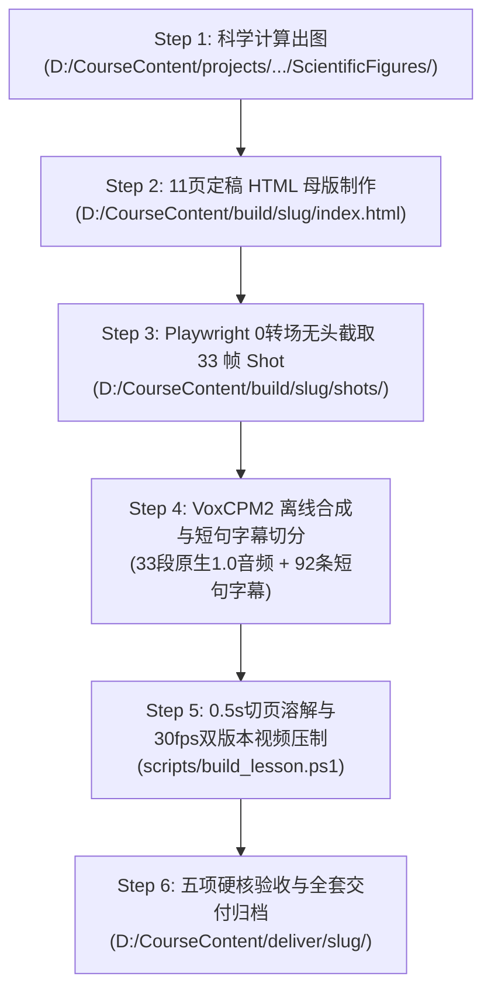

# CourseWorkspace 课程生产最终执行宪章与工业化交付蓝本 (v7.0-Canonical)

> **生效日期**：2026-11-23  
> **基准蓝本**：以已全量验收交付的 `T1-01 汽车为什么本质上是钝体流动问题？` 为全系列唯一母版  
> **执行口径**：代码仓与内容根绝对物理双根隔离；流场物理量必由 Python 方程求解；母版无转场即时截图；切页 0.5s 平滑交叉溶解；短句字幕 30fps 实时对齐；零二手工具水印；语速严格锁定 1.0。

---

## 一、 核心生产五大铁律（绝对封堵翻车源头）

| 铁律项 | 核心要求 | 违规判定与处罚 |
| :--- | :--- | :--- |
| **1. 双根物理隔离铁律** | **代码仓零媒体，产物全进内容根**。开发工作区 `CourseWorkspace` 仅保留代码、编译脚本与 JSON Schemas。所有课程母版、图表、CFD 算例、分镜切片、配音、数据库与成片 100% 落地在 `D:\CourseContent`（中间构建在 `build/<slug>/`，终版交付在 `deliver/<slug>/`）。 | 代码仓出现任何 `.png`、`.mp4`、`.wav` 或 `.db` 文件，直接判定违规。 |
| **2. 视觉与科学生成铁律** | **严禁 AI 凭空手绘物理 SVG**。所有二维流线、速度剖面、压力系数 $C_p$、阻力构成与标尺图，必须由 `projects/<course_id>/ScientificFigures/` Python 脚本（NumPy/Matplotlib/Scipy 势流、边界层积分、基准实验数据）真实解出，统一输出 `#FAF9F6` 米白底出版级矢量图与高清位图。 | 出现任何手绘假流线、凭空沙漏或虚构曲线，全集直接打回重做。 |
| **3. 学术引用合规铁律** | **严禁二手工具水印与工程调试标签**。彻底禁用 `NotebookLM`、`AI generated`、`BUILD-SPEC` 等内部标签。原书图必须严格标注至作者、书名、版次、图号与页码；科学重算图必须明确注明求解算法与理论来源。 | 画面或页脚残留任何二手工具字眼，视为学术不合规，一票否决。 |
| **4. 母版截图与切页铁律** | **母版 0 转场截取，视频层 0.5 秒平滑交叉溶解**。母版 HTML 强制配置 `transition: 'none'`，Step 点亮即时生效（`opacity: 0.22 → 1`），杜绝截图截入半透明过渡残影；视频合轨层在 10 处切页时利用口播 0.8s 留白期注入 15 帧（0.500 秒）平滑溶解，页内步进硬切。 | 出现切页残影悬挂多秒或叠画拖泥带水，全集重新截图与压制。 |
| **5. 视听与字幕对齐铁律** | **短句动态步进与双版本交付**。讲稿按 135–140 wpm 编写总师级英文，TTS 原生 `speed: 1.0`；长段落拆解为 3~5 秒独立短句；FFmpeg 滤镜链注入 `fps=30` 确保 `libass` 实时每 3~5 秒换句；全集必须同时输出无字幕纯净版、下沉短句烧录版及 4 套独立外挂字幕（`.bilingual.srt`、`.en.srt`、`.zh.srt`、`.ass`）。 | 字幕单句卡死不刷新、字幕挡图或缺少任一格式，视为未完成交付。 |

---

## 二、 单集最小可交付闭环（6 步标准化工作流）



### Step 1：Python 科学计算出图（落盘至 Content Root）
1. 在 `D:\CourseContent\projects\automotive-aerodynamics\ScientificFigures\figures\` 下建立或调用单集脚本；
2. 基于真实物理方程求解：
   - 势流面板法（Panel Method）/ 奇点镜像法（Method of Images）求解流函数 $\psi$；
   - 边界层方程（Blasius / 湍流 1/7 次幂律）求解速度剖面 $u(y)$；
   - 工程数据带误差棒（Error bars）与置信区间；
3. 样式必须对齐：背景色 `#FAF9F6`，文字色 `#252A31`，强调橙 `#E8733B`，图表容器高度严格控制在 215px / 265px 防止溢出；
4. 运行导出至 `D:\CourseContent\build\<slug>\assets\`。

### Step 2：11 页定稿 HTML 母版制作
1. 在 `D:\CourseContent\build\<slug>\` 建立 `index.html` 与 `assets/`；
2. 严格遵循 McKinsey-Orange 视觉网格：
   - 画布：固定 1920 × 1080；
   - Reveal 配置：`transition: 'none', transitionSpeed: 'default'`；
   - 样式：`.step-dim { opacity: 0.22 !important; }`，`.step-active { opacity: 1 !important; }`；
   - 容器高度：多图卡片容器高度控制在 215px，三栏流程容器控制在 265px；
   - 字体与公式：行内公式统一采用 KaTeX 标签样式（如 `<i>R</i><sub>e</sub>`、`<i>C</i><sub>D</sub>`、`<i>v</i><sup>3</sup>`），杜绝原生未渲染的 `$` 字符；
   - 页脚：左侧作者原书规范引文，右侧序号 `XX / 11`。

### Step 3：Playwright 0 转场无头截取 33 帧 Shot
1. 运行 `node scripts/capture_all_shots.mjs`；
2. 逐页跳转并等待 300ms，遍历 Step 1~3 并等待 200ms；
3. 自动将 33 帧 1080P 高清 Shot 输出至 `D:\CourseContent\build\<slug>\shots\shot-*.png`。

### Step 4：VoxCPM2 离线配音与 3~5 秒短句切分
1. 讲稿遵循“零元叙事”准则，严禁出现“看屏幕”、“本页展示”、“AI生成”等元废话，总师视角纯口播；
2. 调用 `scripts/synth_offline_voxcpm.py` 合成 33 段原生 `speed: 1.0`（135–140 wpm）48kHz WAV 音频，串接为 `narration_full.wav`，写入 `timeline_metadata.json`；
3. 运行 `scripts/build_refined_subtitles.py`，将 33 个长段落拆解为 80~100 条短句（每句约 3~5 秒），生成双语与单语 SRT 及 ASS 字幕。

### Step 5：视频合轨与 0.5s 切页平滑溶解
1. 运行标准构建入口：
   ```powershell
   .\scripts\build_lesson.ps1 -Lesson <slug>
   ```
2. 自动在 10 处切页的 0.8s 口播留白期注入 15 帧（0.500 秒）平滑交叉溶解帧；
3. 视频滤镜注入 `fps=30`，确保 `libass` 每秒接收 30 帧连续输入，短句字幕随口播毫秒级刷新；
4. 并行压制输出无字幕纯净版与精致烧录版。

### Step 6：交付物全套核验（全部落地至 deliver/）
核验 `D:\CourseContent\deliver\<slug>\` 下的 6 项交付产物：
1. `<slug>-clean.mp4`：无字幕纯净版（1080P 30fps，320kbps AAC）；
2. `<slug>.mp4`：有字幕烧录版（1080P 30fps，短句动态步进，`MarginV=24` 下沉防遮挡）；
3. `<slug>.bilingual.srt`：中英双语独立字幕；
4. `<slug>.en.srt`：YouTube CC 纯英文字幕；
5. `<slug>.zh.srt`：Bilibili CC 纯中文字幕；
6. `<slug>.ass`：高保真样式字幕。

---

## 三、 T1 模块后续各集（T1-02 ~ T1-05）出图与重点任务规划

| 单集编号与标题 | 建议时长 | 必须调用的 Python 科学计算出图任务 | 核心原书图表支撑 (Hucho 5th ed) |
| :--- | :---: | :--- | :--- |
| **T1-01 钝体流动本质** | 9 min | ① NACA0012 附着流 vs 钝体大尾迹流场对比<br>② 镜像法近地面绕流 + 湍流边界层真实剖面<br>③ 阻力构成水平柱状图 (70%–80%) 与 $Re \sim 10^7$ 对数标尺图 | Fig. 1.1 气动任务谱<br>Fig. 1.3 两类分离机制<br>Fig. 1.4 烟线与 CFD 对比 |
| **T1-02 阻力与功率三次方** | 9 min | ① 动压 $q=\frac{1}{2}\rho v^2$ 与风阻功率 $P \propto v^3$ 曲线（80/100/120 km/h 暴涨图）<br>② $\Delta C_D = -0.01$ 对燃油车节油与纯电续航提升的敏感度图 | Fig. 1.8 功率随车速演化曲线<br>Fig. 1.10 功率敏感度对比柱状图 |
| **T1-03 百年流线型反思** | 9 min | ① 对称自由流线体在近地面（$h/H \to 0$）产生的严重负压与畸变升力曲线<br>② Jaray 半体（Half-body）解析几何流线压缩模型 | Fig. 1.12 Jaray 专利半体拓扑图<br>Fig. 1.16 翼型近地面失稳速度场 |
| **T1-04 车尾造型分类学** | 9 min | ① 三大车尾形态（Notchback, Fastback, Squareback）后部流线拓扑重构<br>② 车尾表面压力回升曲线 $C_p(x)$ 对比（背风面死水区与分离点位置） | Fig. 1.34 车尾分类与 $C_D$ 谱系<br>Fig. 1.38 尾部再附着压力回升图 |
| **T1-05 现代气动开发闭环** | 10 min | ① 外形优化（Shape Optimization）与细节优化（Detail Optimization）贡献漏斗图<br>② 造型-工程多目标冲突帕累托前沿曲线（Pareto Frontier） | Fig. 1.67 奔驰 SL 60 年气动演进矩阵<br>Fig. 1.68 六边形工程约束交集图 |
